# AI-POWERED CROP HEALTH INTELLIGENCE SYSTEM

**A Capstone Project Report**  
submitted in partial fulfillment of the requirements for the degree of

**Bachelor of Technology**  
in  
**Computer Science and Engineering**

by

**Nayanah Soju**  
Registration Number: [PLACEHOLDER]

Under the guidance of  
**[PLACEHOLDER – Project Guide Name]**  
[PLACEHOLDER – Designation, Department]

---

**SCHOOL OF COMPUTER SCIENCE AND ENGINEERING**  
**VIT-AP UNIVERSITY**  
**Amaravati, Andhra Pradesh — 522 237**  
**November 2026**

---

## BONAFIDE CERTIFICATE

This is to certify that the capstone project titled **"AI-Powered Crop Health Intelligence System"** submitted by **Nayanah Soju** (Registration Number: [PLACEHOLDER]) in partial fulfillment of the requirements for the award of the degree of **Bachelor of Technology in Computer Science and Engineering** from VIT-AP University, Amaravati, is a record of bonafide work carried out under my supervision.

The contents of this report have not been submitted previously for the award of any degree or diploma to any other institution.

&nbsp;

**[PLACEHOLDER – Project Guide]**  
*Guide Signature*  
[Designation, Department]  
VIT-AP University

&nbsp;

**[PLACEHOLDER – Program Chair]**  
*Program Chair Signature*  
School of Computer Science and Engineering

&nbsp;

**[PLACEHOLDER – Dean]**  
*Dean Signature*  
School of Computer Science and Engineering

&nbsp;

**[PLACEHOLDER – External Examiner]**  
*External Examiner Signature*  
[Institution]

---

## DECLARATION

I, **Nayanah Soju** (Registration Number: [PLACEHOLDER]), hereby declare that the capstone project titled **"AI-Powered Crop Health Intelligence System"** submitted to VIT-AP University in partial fulfillment of the requirements for the degree of Bachelor of Technology in Computer Science and Engineering is my own original work.

I further declare that:

1. This work has not been submitted previously, in full or in part, for the award of any degree or diploma at this or any other institution.
2. All sources of information used in this report have been duly acknowledged and referenced.
3. The implementation, training, evaluation, and analysis described in this report were performed by me.
4. Any assistance received from peers, advisors, or open-source communities has been acknowledged appropriately.

&nbsp;

**Nayanah Soju**  
Registration Number: [PLACEHOLDER]  
School of Computer Science and Engineering  
VIT-AP University  
Date: November 2026

---

## ACKNOWLEDGEMENTS

I would like to express my sincere gratitude to my project guide, **[PLACEHOLDER]**, for their consistent support, timely feedback, and guidance throughout the development and documentation of this project. Their encouragement helped me navigate the technical challenges of building an end-to-end machine-learning system.

I am thankful to the **School of Computer Science and Engineering, VIT-AP University**, for providing the academic environment and infrastructure that made this work possible.

I am grateful to the creators and contributors of the **PlantVillage** dataset, the **GVLiD-v5** grape leaf image dataset, and the broader open-source communities behind PyTorch, FastAPI, React, and the many supporting libraries used in this project. Without publicly available datasets and open-source software, work of this kind would not be feasible for an undergraduate research prototype.

Finally, I thank my family and friends for their patience and encouragement during the demanding phases of this project.

---

## ABSTRACT

Crop diseases cause substantial agricultural losses each year, particularly in regions where smallholder farmers lack access to specialist agronomic advice. Early, accurate identification of disease is essential to limiting crop damage and economic loss, yet manual inspection is slow, inconsistent, and dependent on expert availability. This project describes the design, implementation, and evaluation of an **AI-Powered Crop Health Intelligence System** — a full-stack research prototype that integrates deep learning classification, visual model explainability, disease knowledge retrieval, and real-time weather context in a single web application.

The system uses two independently trained **EfficientNet-B0** classifiers: one covering tomato and potato diseases (seven classes), and another covering grape diseases (three classes). Both classifiers were fine-tuned from ImageNet pretrained weights on subsets of the PlantVillage dataset, with the grape model additionally trained on the GVLiD-v5 augmentation set. Training used group-aware stratified splits to prevent source-group leakage across train, validation, and test partitions. On held-out test sets, the tomato-potato classifier achieved **99.70% accuracy** (1,317 samples) and the grape classifier achieved **99.26% accuracy** (544 samples).

The backend exposes a REST API built with **FastAPI**, backed by **SQLite** for prediction history persistence. At inference time, the API runs the EfficientNet-B0 forward pass, computes a **Grad-CAM** overlay to highlight the spatial regions that most influenced the prediction, applies an HSV-based lesion severity estimator when a pixel mask is provided, and assembles a source-traceable disease-management recommendation from a curated knowledge base. If a location is supplied, the API retrieves current weather observations from the **Open-Meteo** REST API and applies YAML-defined weather rules to generate weather-conditioned guidance.

The **React 18** frontend presents the full result stack — predicted class, confidence scores, Grad-CAM heatmap, severity estimate, disease information, general management guidance, and optional weather context — in a single-page interface with a separate prediction history view.

The system is evaluated exclusively on internal test-set holdouts derived from PlantVillage and GVLiD-v5; no external field-collected images were used for evaluation. The severity estimator is an image-processing heuristic, not a validated agronomic model. All results should be treated as decision support and confirmed by qualified agricultural professionals before action is taken.

**Keywords:** crop disease detection, EfficientNet-B0, Grad-CAM, PlantVillage, FastAPI, React, severity estimation, plant disease classification

---

## TABLE OF CONTENTS

- [BONAFIDE CERTIFICATE](#bonafide-certificate)
- [DECLARATION](#declaration)
- [ACKNOWLEDGEMENTS](#acknowledgements)
- [ABSTRACT](#abstract)
- [LIST OF FIGURES](#list-of-figures)
- [LIST OF TABLES](#list-of-tables)
- [Chapter 1 — Introduction](#chapter-1--introduction)
- [Chapter 2 — Proposed System and Methodology](#chapter-2--proposed-system-and-methodology)
- [Chapter 3 — Cost Analysis](#chapter-3--cost-analysis)
- [Chapter 4 — Results and Discussion](#chapter-4--results-and-discussion)
- [Chapter 5 — Conclusion and Future Work](#chapter-5--conclusion-and-future-work)
- [Chapter 6 — Appendix](#chapter-6--appendix)
- [Chapter 7 — References](#chapter-7--references)
- [Biodata](#biodata)

---

## LIST OF FIGURES

| Figure | Caption |
|--------|---------|
| Figure 1 | Overall System Architecture — Crop Health Intelligence |
| Figure 2 | Dataset Split Methodology (Group-Aware Stratified) |
| Figure 3 | EfficientNet-B0 Inference Pipeline |
| Figure 4 | Tomato–Potato Training and Validation Curves |
| Figure 5 | Grape Training and Validation Curves |
| Figure 6 | Multi-Crop Routing Logic |
| Figure 7 | End-to-End Prediction Workflow |
| Figure 8 | Grad-CAM Generation Workflow |
| Figure 9 | Grad-CAM Overlay Samples (Grape Leaf Images) |
| Figure 10 | Severity Estimation Workflow (HSV Foreground Masking) |
| Figure 11 | Severity Estimation Demo (Annotated Lesion Mask) |
| Figure 12 | Weather and Recommendation Pipeline |
| Figure 13 | Frontend–Backend Communication |
| Figure 14 | Database Persistence Workflow |
| Figure 15 | Application Screenshot — Dashboard and Crop Selector |
| Figure 16 | Application Screenshot — Leaf Image Upload |
| Figure 17 | Application Screenshot — Prediction Results |
| Figure 18 | Application Screenshot — Grad-CAM Heatmap and Overlay |
| Figure 19 | Application Screenshot — Disease Recommendations |
| Figure 20 | Application Screenshot — Prediction History |
| Figure 21 | Tomato–Potato Confusion Matrix (Test Set, 1,317 Samples) |
| Figure 22 | Grape Confusion Matrix (Test Set, 544 Samples) |
| Figure 23 | Per-Class Precision, Recall, and F1 Scores |

---

## LIST OF TABLES

| Table | Caption |
|-------|---------|
| Table 1 | Dataset Partitions — Tomato–Potato and Grape |
| Table 2 | Training Configuration |
| Table 3 | Tomato–Potato Per-Class Classification Metrics |
| Table 4 | Grape Per-Class Classification Metrics |
| Table 5 | Backend Test Suite Results |
| Table 6 | Knowledge Base Disease Entries |
| Table 7 | Technology Stack Summary |

---

## Chapter 1 — Introduction

### 1.1 Introduction

Agriculture is one of the foundations of the Indian economy, employing a large fraction of the rural population and directly influencing food security at both the household and national level. Among the many threats to agricultural productivity, plant diseases stand out as consistently damaging and difficult to control. A diseased crop can lose a significant portion of its marketable yield before visible symptoms become obvious, and by the time a farmer recognises the problem the economic damage may already be done.

Traditional disease diagnosis relies on physical inspection by an agronomist or extension worker. This model has two fundamental problems. First, the number of qualified plant pathologists is insufficient relative to the size of the farming population, particularly in rural and semi-arid regions. Second, visual diagnosis is inherently subjective; the same set of symptoms can be interpreted differently by different practitioners, leading to inconsistent management decisions. Taken together, these problems mean that many farmers either receive no expert guidance or receive it too late to be useful.

The rise of deep learning, and specifically convolutional neural networks trained on large image collections, has created an opportunity to build automated decision-support tools that can partially bridge this gap. Given a photograph of a diseased leaf, a well-trained classifier can identify the disease with accuracy that compares favourably with human experts on certain controlled datasets. What sets the system described in this report apart is that it does not stop at classification. It combines the classifier output with an explainability layer, a severity estimate, a curated knowledge base, and real-time weather data to give the user a richer, more actionable result — presented through a modern web interface that runs on any device with a browser.

### 1.2 Background

The idea of using machine learning for plant disease detection has been an active area of research since at least the mid-2000s, but it gained significant momentum after Mohanty et al. [1] demonstrated in 2016 that a deep convolutional neural network trained on the PlantVillage dataset [2] could achieve over 99% accuracy at identifying 26 disease classes across 14 crop types under controlled photographic conditions. That work established PlantVillage as the standard benchmark dataset for the field and showed that transfer learning from ImageNet pretrained weights is an effective starting point for plant disease models.

Subsequent work has explored a range of directions: improving robustness to real field conditions [3], lightweight models suitable for mobile deployment [4], attention mechanisms that highlight relevant image regions [5], and multi-task architectures that jointly classify disease and estimate severity [6]. The EfficientNet family [7], introduced by Tan and Le in 2019, is particularly relevant here — it is a family of models that scales network depth, width, and resolution jointly using a compound coefficient, achieving state-of-the-art accuracy on ImageNet at a substantially lower parameter count than predecessors such as ResNet or VGG.

Explainability has become increasingly important as deep learning is applied to consequential domains. Gradient-weighted Class Activation Mapping (Grad-CAM) [8], proposed by Selvaraju et al. in 2017, provides a way to visualise the spatial regions of an input image that contributed most to a particular class prediction. For a leaf disease classifier, Grad-CAM overlays can help a practitioner verify that the model is attending to the diseased tissue rather than background artefacts — an important sanity check before trusting the prediction.

### 1.3 Problem Statement

Smallholder and subsistence farmers in India and similar agricultural economies lack affordable, accessible tools for early crop disease identification. Expert agronomists are geographically concentrated in urban centres and are difficult to reach during critical growing seasons. Mobile internet connectivity is increasingly widespread, but crop disease applications are either too simplistic (single-class outputs with no explanation) or too heavy for low-bandwidth conditions.

A tool that:
1. Correctly identifies disease from a smartphone photograph of a leaf,
2. Shows the farmer *what* in the image led to the prediction,
3. Estimates how severe the infestation currently appears,
4. Retrieves contextually relevant management guidance, and
5. Notes whether current weather conditions match patterns associated with the disease,

...would provide substantially more actionable information than raw classification alone.

This project builds exactly such a system, with the additional constraint that all outputs carry explicit source attributions — so that any guidance can be verified against the agronomic literature from which it was drawn.

### 1.4 Motivation

Several converging factors motivated this project:

**Feasibility of deep learning on consumer hardware.** EfficientNet-B0, the smallest variant in the EfficientNet family, trains to high accuracy on PlantVillage subsets in a matter of hours on CPU — no GPU cluster is required for a research prototype of this scale.

**Availability of open-source datasets.** The PlantVillage dataset provides tens of thousands of labelled plant disease images under a permissive licence. The GVLiD-v5 grape augmentation set adds diversity for the grape disease classes, reducing overfitting to the original photographic conditions.

**Mature open-source tooling.** PyTorch, FastAPI, and React together provide a production-quality software stack that an undergraduate developer can reason about and maintain. The ecosystem is well-documented, actively maintained, and free of licensing restrictions.

**Demand for explainable AI.** There is growing recognition, both in academic literature and regulatory contexts, that AI outputs in consequential domains need to be traceable to evidence and understandable to non-specialists. Building source-traceability and Grad-CAM explainability into the system from the start, rather than bolting them on later, reflects this priority.

### 1.5 Limitations of Existing Approaches

Most published plant disease detection systems have one or more of the following shortcomings when evaluated against the requirements stated above:

- **Classification only.** The system returns a disease label and perhaps a confidence score, but provides no explanation of which image regions drove the prediction, no estimate of severity, and no management guidance.
- **No source attribution.** Guidance text is generated without linking it to the agronomic sources from which it was derived, making it impossible to verify or update.
- **Controlled-condition evaluation only.** Models are trained and evaluated on clean, well-lit, isolated leaf photographs that do not reflect field conditions. Generalisation is assumed rather than measured.
- **Single-crop focus.** Most published models cover a single crop or a small number of closely related species, limiting practical utility.
- **Monolithic deployment.** Many academic prototypes are standalone scripts or notebooks with no web interface, making them inaccessible to non-technical users.

This project addresses the first four limitations directly. The fifth is addressed by providing a fully functional React/Vite single-page application with a persistent prediction history.

### 1.6 Proposed System

The proposed system is a full-stack web application comprising:

- **Two EfficientNet-B0 classifiers** covering tomato+potato (7 classes) and grape (3 classes), trained on PlantVillage and GVLiD-v5 data.
- **A Grad-CAM explainability module** that produces a heatmap overlay for every prediction.
- **An HSV-based severity estimator** that quantifies lesion area as a percentage of estimated leaf area when an annotated pixel mask is supplied.
- **A curated knowledge base** of 10 disease and healthy-class entries, each with symptoms, management guidance, and source links.
- **A weather integration module** that retrieves current observations from Open-Meteo and applies YAML-defined weather rules to generate contextual guidance.
- **A FastAPI backend** that orchestrates all of the above and persists each prediction to a SQLite database.
- **A React 18 frontend** that presents the complete result stack and maintains a browsable prediction history.

### 1.7 Objectives

The specific objectives of this project are:

1. To train and evaluate EfficientNet-B0 classifiers for tomato, potato, and grape disease identification.
2. To implement Grad-CAM visualisation for model explainability.
3. To implement an image-processing severity estimator using HSV colour-space analysis.
4. To build a curated disease knowledge base with source-attributed management guidance.
5. To integrate real-time weather data into the recommendation pipeline.
6. To develop a RESTful FastAPI backend with database persistence and health monitoring.
7. To build a React SPA that presents all outputs in a usable interface.
8. To verify the system end-to-end through automated tests and to document limitations honestly.

### 1.8 Scope

**In scope:**
- Classification of tomato (5 disease + 1 healthy), potato (2 disease), and grape (3 disease/healthy) leaf images.
- Grad-CAM overlay generation for each prediction.
- Severity estimation when a co-registered lesion mask is provided.
- Knowledge-base retrieval and rule-based weather guidance.
- Backend REST API with SQLite persistence.
- React SPA with upload, result display, and history views.
- Automated test suites for backend logic and frontend components.

**Out of scope:**
- Field-collected image evaluation (all evaluation uses internal held-out test sets from PlantVillage / GVLiD-v5).
- Hardware deployment (IoT sensors, edge devices, Arduino, cameras).
- Mobile-native applications.
- Real-time streaming inference.
- Model retraining or active learning from user feedback.
- Support for crop types beyond tomato, potato, and grape.

### 1.9 Literature Survey

**Mohanty et al. (2016)** [1] trained a GoogLeNet and AlexNet on 54,306 PlantVillage images covering 26 diseases across 14 crops, achieving 99.35% top-1 accuracy in a controlled setting. The paper noted a significant accuracy gap when tested on real field images, a limitation that remains relevant to the present work.

**Hughes and Salathé (2015)** [2] published the PlantVillage dataset and baseline results, establishing the first large-scale open benchmark for plant disease detection. Their dataset of over 54,000 controlled-condition photographs laid the foundation for most subsequent work in the field.

**Tan and Le (2019)** [7] introduced EfficientNet, showing that scaling network depth, width, and input resolution by a compound coefficient derived from a neural architecture search significantly outperforms previous scaling heuristics. EfficientNet-B0, the base model, achieves 77.1% top-1 accuracy on ImageNet with only 5.3M parameters — an attractive starting point for fine-tuning on domain-specific tasks where labelled data are limited.

**Selvaraju et al. (2017)** [8] proposed Grad-CAM as a generalisation of Class Activation Mapping that does not require modifications to the network architecture. The technique backpropagates the class score gradient to the final convolutional layer and weights the activation maps by the gradient's global average over spatial dimensions, producing a coarse but meaningful saliency map. For EfficientNet-B0, the target layer is the final feature block (`model.features[-1]`), which produces 7×7×1280 activation tensors at 224×224 input resolution.

**He et al. (2016)** [9] introduced ResNet and demonstrated the effectiveness of residual connections for training deep networks, an architectural innovation that underpins EfficientNet and many other modern classifiers.

**Ferentinos (2018)** [10] applied CNNs to 87,848 plant images from PlantVillage, training AlexNet, VGGNet, and GoogLeNet variants and reporting up to 99.53% accuracy. The study confirmed that transfer learning from ImageNet substantially reduces the training data required for domain adaptation.

**Chen et al. (2020)** [11] surveyed deep learning methods for plant disease recognition, identifying key challenges including dataset bias, limited diversity of photographic conditions, and the absence of standardised evaluation protocols. These challenges inform the limitations stated throughout this report.

**Open-Meteo (2023)** [12] provides a free, no-API-key REST interface for current and forecast weather data worldwide, using the ERA5 reanalysis and national weather model outputs. The system accesses the geocoding endpoint to resolve location strings to coordinates and the forecast endpoint for current observations.

### 1.10 Report Organisation

The remainder of this report is structured as follows. Chapter 2 describes the proposed system in detail, covering dataset preparation, model architecture, training configuration, the explainability and severity estimation modules, the knowledge base, weather integration, the backend API design, the frontend application, and the database schema. Chapter 3 provides a cost analysis of the software stack and infrastructure. Chapter 4 presents the evaluation results, test outcomes, and discusses the findings. Chapter 5 concludes the report and proposes directions for future work. Chapter 6 contains code appendices. Chapter 7 lists the references.

---

## Chapter 2 — Proposed System and Methodology

### 2.1 System Architecture Overview

The system is organised into five layers, illustrated in Figure 1:

1. **Presentation Layer** — React 18 single-page application served by Vite 8.3.1.
2. **API Layer** — FastAPI application exposing REST endpoints; request size limited to 1 MB by middleware.
3. **ML and Processing Layer** — Classifier inference, Grad-CAM, severity estimation, knowledge-base retrieval, and recommendation engine.
4. **Data Layer** — SQLite database (via SQLAlchemy ORM and Alembic migrations) for prediction history.
5. **External Services Layer** — Open-Meteo REST API for weather data.

The frontend communicates with the backend exclusively over HTTP. The backend handles all model inference synchronously within the request lifecycle. No message queue or asynchronous task worker is used in the current prototype.

**Figure 1 — Overall System Architecture**  
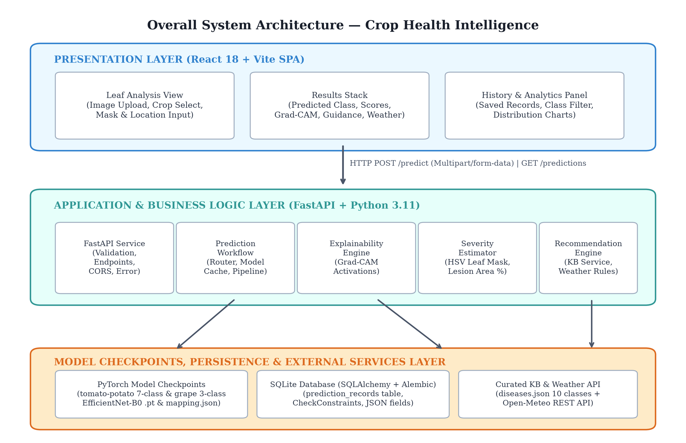

### 2.2 Dataset Description

**PlantVillage** [2] is the primary training source. The dataset contains controlled-condition photographs of healthy and diseased plant leaves across multiple crop types. All images are segmented to show only the leaf, with uniform backgrounds. For this project, the following classes were used:

*Tomato classes (5 disease + 1 healthy + potato classes in same model):*

| Class ID | Description |
|----------|-------------|
| tomato_healthy | Healthy tomato leaf |
| tomato_early_blight | Tomato early blight (*Alternaria solani*) |
| tomato_late_blight | Tomato late blight (*Phytophthora infestans*) |
| tomato_leaf_mold | Tomato leaf mould (*Passalora fulva*) |
| tomato_septoria_leaf_spot | Tomato septoria leaf spot (*Septoria lycopersici*) |
| potato_early_blight | Potato early blight (*Alternaria solani*) |
| potato_late_blight | Potato late blight (*Phytophthora infestans*) |

*Grape classes:*

| Class ID | Description |
|----------|-------------|
| grape_black_rot | Grape black rot (*Guignardia bidwellii*) |
| grape_esca | Grape Esca (Black Measles) |
| grape_isariopsis_leaf_spot | Grape Isariopsis leaf spot (*Isariopsis clavispora*) |

The **GVLiD-v5** (Grape Variety Leaf Image Dataset, version 5) augmentation set was used as an additional source of grape leaf images. This dataset provides augmented variants of grape disease images under varied photographic conditions, reducing the risk of the grape model overfitting to PlantVillage's controlled photographic style.

**PlantDoc** was explicitly *not* used for training or evaluation in either model run; this is noted in the evaluation result JSON files for both runs.

### 2.3 Dataset Splitting Methodology

A group-aware stratified split was applied to prevent source-group leakage between train, validation, and test partitions. Each image is assigned to a source group (e.g., the original folder or augmentation batch from which it was drawn), and all images from the same source group are kept within the same split. This prevents the model from achieving artificially high test accuracy by memorising features specific to a photographic source rather than the disease itself.

The split ratios and resulting partition sizes are shown in Table 1.

**Table 1 — Dataset Partitions**

| Model | Train | Validation | Test | Total |
|-------|-------|------------|------|-------|
| Tomato-Potato | 6,145 | 1,317 | 1,317 | 8,779 |
| Grape | 2,531 | 544 | 544 | 3,619 |

Both splits are fixed by a seed of 42 and recorded in a split manifest with SHA-256 checksums (Tomato-Potato: `40b08f14…`, Grape: `9978dff1…`), ensuring reproducibility.

**Figure 2 — Dataset Split Methodology (Group-Aware Stratified)**  
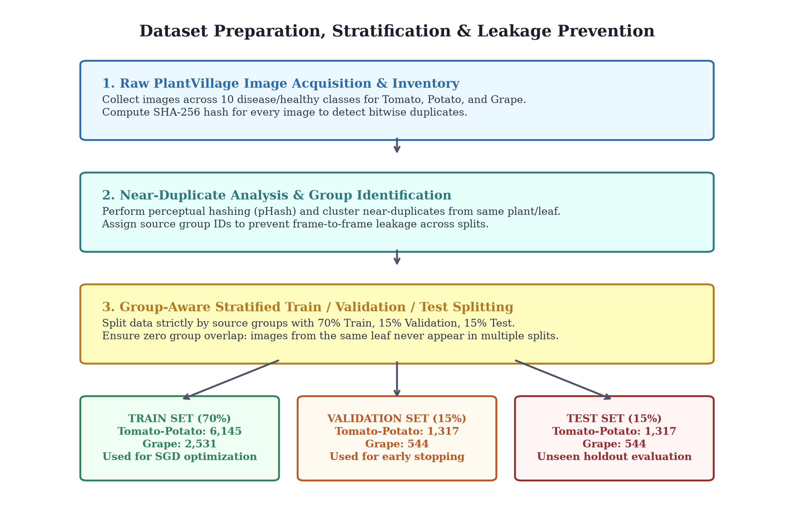

### 2.4 Preprocessing Pipeline

All input images, both during training and inference, are processed through the same pipeline:

1. **EXIF orientation correction** — `PIL.ImageOps.exif_transpose` is applied to correct images that have orientation metadata encoded (e.g., phone photographs taken in portrait mode).
2. **RGB conversion** — The image is converted to 3-channel RGB to handle greyscale or RGBA inputs uniformly.
3. **Bicubic resize** — The image is resized to 224×224 pixels using bicubic interpolation.
4. **Tensor conversion** — Pixel values are scaled from [0, 255] to [0.0, 1.0] by dividing by 255.
5. **ImageNet normalisation** — Mean subtraction and standard-deviation normalisation using ImageNet statistics: mean = (0.485, 0.456, 0.406), std = (0.229, 0.224, 0.225) per channel.

The output is a float32 tensor of shape (3, 224, 224) suitable for direct input to the EfficientNet-B0 model.

### 2.5 Model Architecture — EfficientNet-B0

The classifier is an **EfficientNet-B0** [7] architecture. The base model is initialised with ImageNet pretrained weights and then fine-tuned on the plant disease classes. The final fully connected layer is replaced with a linear layer whose output dimension equals the number of disease classes (7 for tomato-potato, 3 for grape).

EfficientNet-B0 uses a mobile inverted bottleneck (MBConv) block structure with squeeze-and-excitation modules. At 224×224 input resolution, the final feature block (`model.features[-1]`) produces activation tensors of shape (batch, 1280, 7, 7) — a 7×7 spatial grid of 1280-dimensional feature vectors. This feature map is the hook target for Grad-CAM.

The model is built using the `torchvision.models.efficientnet_b0` factory function. Total parameters are approximately 5.3M for EfficientNet-B0, with the full model fine-tuned (all layers updated during training) on the plant disease data.

**Figure 3 — EfficientNet-B0 Inference Pipeline**  
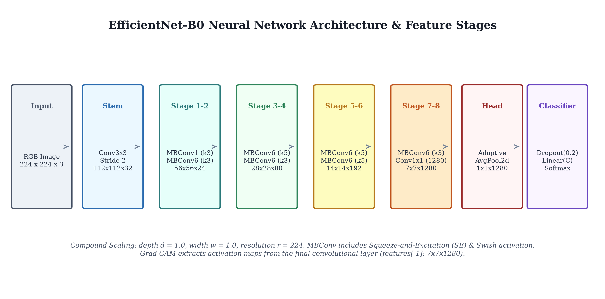

### 2.6 Training Configuration

Training was performed entirely on CPU. The key hyperparameters, confirmed from the training configuration files, are:

**Table 2 — Training Configuration**

| Parameter | Value |
|-----------|-------|
| Optimiser | Adam |
| Learning rate | 0.0003 |
| Weight decay | 0.0001 |
| Batch size | 32 |
| Input image size | 224×224 |
| Early stopping patience | 5 epochs |
| Random seed | 42 |
| Device | CPU |

The tomato-potato model reached its best validation performance at **epoch 11** and completed **16 epochs** before early stopping. The grape model reached its best at **epoch 1** and completed **6 epochs** before early stopping, reflecting the relative simplicity of the 3-class problem.

Checkpoint files save the model `state_dict` together with the class ID list for consistency validation. At load time, the system verifies that the checkpoint's class list matches the class mapping file; a mismatch raises a `ValueError` to prevent silent errors from mismatched model/mapping pairs.

**Figure 4 — Tomato–Potato Training and Validation Curves**  
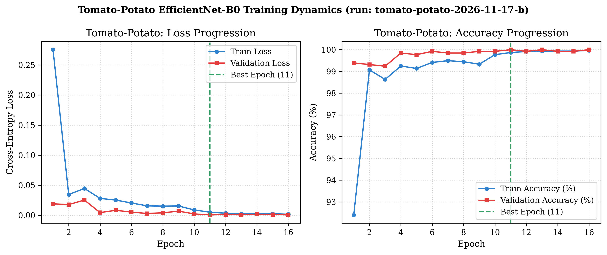

**Figure 5 — Grape Training and Validation Curves**  
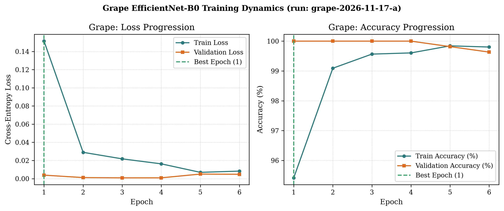

### 2.7 Multi-Crop Routing

The system uses two separate classifiers rather than a single multi-output model. The `crop` field supplied in the POST `/predict` request determines which classifier is loaded. This design allows each classifier to be trained, versioned, and swapped independently.

The routing table in `PredictionWorkflow` maps crop names to their respective checkpoint and class-mapping paths:

```
crop_to_route = {
    "tomato": <tomato-potato checkpoint, tomato-potato class mapping>,
    "potato": <tomato-potato checkpoint, tomato-potato class mapping>,
    "grape":  <grape checkpoint, grape class mapping>,
}
```

If the `crop` field is absent or does not match a supported crop, the endpoint returns HTTP 422 with a descriptive error listing the supported values. This is enforced at the top of the predict endpoint before any model loading occurs.

**Figure 6 — Multi-Crop Routing Logic**  
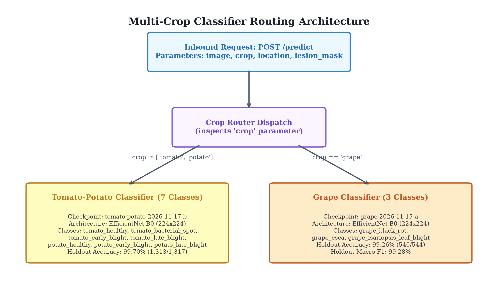

### 2.8 Inference Flow

The end-to-end inference flow, illustrated in Figure 7, proceeds as follows:

1. The user uploads a leaf image and selects a crop (and optionally provides a location and lesion mask).
2. The FastAPI endpoint validates the upload (file type, size, dimensions after EXIF correction).
3. The correct classifier is selected via the crop routing table.
4. The image is preprocessed to a (1, 3, 224, 224) tensor.
5. The model runs a forward pass under `torch.inference_mode()`, producing a (1, N_classes) logit tensor.
6. Softmax is applied to produce class probabilities. The class with the highest probability is returned as the prediction.
7. Grad-CAM is computed (see Section 2.9).
8. If a lesion mask was provided, severity is estimated (see Section 2.10).
9. The recommendation engine is called with the prediction, severity, and location (see Section 2.11).
10. The result, including Grad-CAM images encoded as base64 data URLs, is assembled and persisted to the database.
11. The JSON response is returned to the frontend.

**Figure 7 — End-to-End Prediction Workflow**  
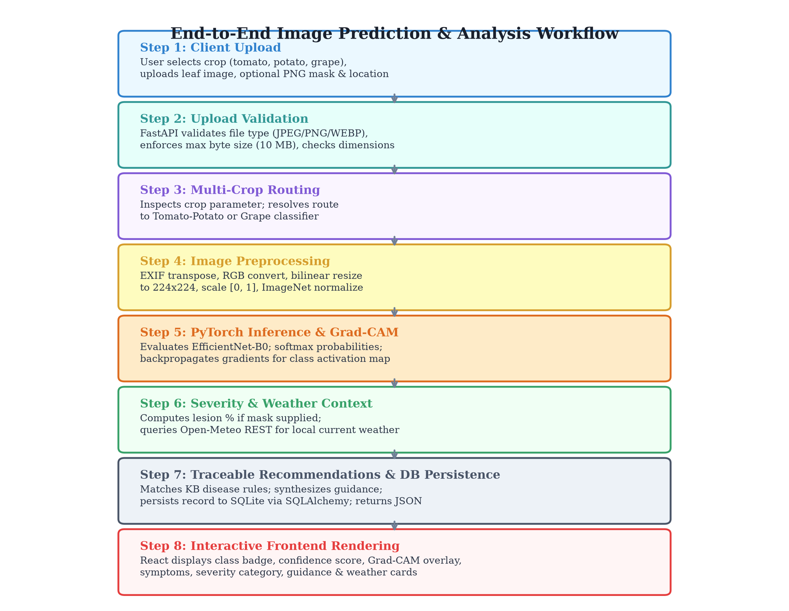

### 2.9 Grad-CAM Explainability

Gradient-weighted Class Activation Mapping (Grad-CAM) [8] produces a coarse spatial heatmap that highlights the image regions most relevant to the classifier's predicted class. The implementation registers a forward hook on `model.features[-1]` (the final EfficientNet feature block) to capture both the feature map activations and their gradients with respect to the class score.

The computation proceeds as follows:

**Step 1 — Forward pass with gradient tracking:**  
The image tensor is passed through the model with gradient computation enabled (the model itself is in eval mode; gradients are only used for the CAM computation). The hook saves the output activation tensor $A \in \mathbb{R}^{1280 \times 7 \times 7}$.

**Step 2 — Backward pass for the predicted class:**  
The class score (pre-softmax logit) for the predicted class is backpropagated. The hook saves the gradient $\nabla A \in \mathbb{R}^{1280 \times 7 \times 7}$.

**Step 3 — Channel weights:**  
The importance weight for each channel $k$ is the global average of its gradient:

$$\alpha_k = \frac{1}{7 \times 7} \sum_{i,j} \frac{\partial S_c}{\partial A_k^{ij}}$$

where $S_c$ is the score for class $c$.

**Step 4 — Weighted sum and ReLU:**  
The class activation map is computed as the ReLU of the weighted sum of feature maps:

$$\text{CAM} = \text{ReLU}\left(\sum_k \alpha_k A_k\right)$$

The ReLU discards features with a negative influence on the predicted class.

**Step 5 — Normalisation and overlay:**  
The 7×7 CAM is normalised to [0, 1], upscaled to the original image resolution using bilinear interpolation, colourised with the 'jet' colormap, and blended with the original image at `alpha = 0.42`.

The output is a `GradCAMResult` dataclass containing the class ID, confidence, class probabilities, the colourised heatmap image, and the overlay image. Both are encoded as base64 PNG data URLs for transmission in the JSON response.

> **Important disclaimer:** Grad-CAM visualises model activations. It does not establish biological causation or confirm that the highlighted tissue is the actual disease region. This caveat is embedded in the code docstring and displayed in the frontend.

**Figure 8 — Grad-CAM Generation Workflow**  
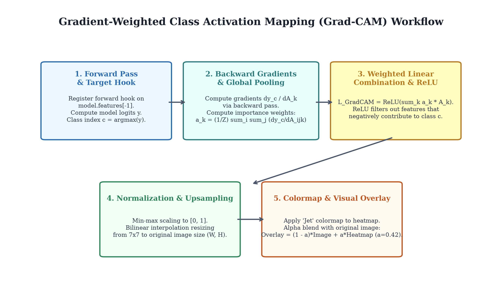

**Figure 9 — Grad-CAM Overlay Samples (Grape Leaf Images)**  
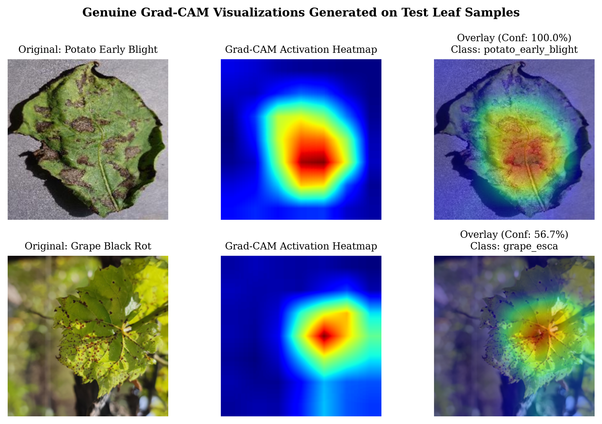

### 2.10 Severity Estimation

The severity estimator is an image-processing module, not a trained deep learning model. It is invoked only when the user provides an aligned lesion mask alongside the leaf image.

**Input:** A leaf image and a co-registered binary PNG mask where positive (non-zero) pixels indicate annotated lesion regions.

**Algorithm:**

1. **Working resolution:** Both the image and mask are downscaled to a maximum dimension defined in the severity configuration (e.g., 1024 pixels on the longest side), using bicubic interpolation for the image and nearest-neighbour for the mask, to keep computation tractable.

2. **Lesion pixels:** Mask pixels above a threshold (from config, e.g., 128) are classified as lesion.

3. **Leaf foreground estimation (HSV masking):** The image is converted to HSV colour space. Pixels whose hue, saturation, and value fall within configured green-leaf ranges are classified as leaf foreground. Morphological closing is then applied to fill gaps, and connected components smaller than a minimum fraction of total pixels are discarded. Lesion pixels are unioned into the foreground mask so that diseased (non-green) tissue is not mistakenly excluded from the leaf area.

4. **Severity percentage:**

$$\text{Severity\%} = \frac{\text{affected\_pixels} \cap \text{leaf\_pixels}}{\text{leaf\_pixels}} \times 100$$

5. **Severity category:**
   - Mild: severity_percentage < 10%
   - Moderate: 10% ≤ severity_percentage < 25%
   - Severe: severity_percentage ≥ 25%

The thresholds are configurable via `configs/severity_config.yaml`. The method name ("HSV-morph") is included in the response so users know what kind of estimate they are receiving.

> **Limitations:** HSV foreground masking can confuse fruit, soil, and shadows with leaf tissue. The severity estimate is explicitly labelled a provisional, image-processing heuristic — not a validated agronomic measurement.

**Figure 10 — Severity Estimation Workflow (HSV Foreground Masking)**  
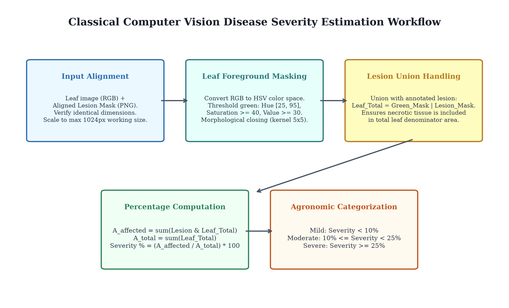

**Figure 11 — Severity Estimation Demo (Annotated Lesion Mask)**  
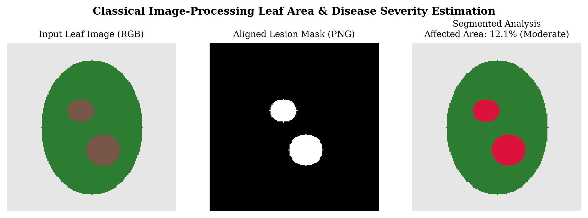

### 2.11 Disease Knowledge Base

The knowledge base is a JSON file (`src/crop_health/knowledge_base/diseases.json`) containing one entry per disease class (plus healthy classes where applicable). Each entry includes:

- `crop`: The crop name (e.g., "Tomato").
- `disease_name`: The human-readable disease name.
- `condition_type`: Either "disease" or "healthy".
- `description`: A one-to-two paragraph description of the condition.
- `symptoms`: A list of observable symptom strings.
- `prevention`: A list of preventive measure strings.
- `general_management`: A list of management guidance strings.
- `favorable_weather_conditions`: Weather conditions known to favour disease development (used by the weather rule engine).
- `sources`: A list of objects with `title`, `organization`, and `url` fields linking to the agronomic literature.

**Table 6 — Knowledge Base Disease Entries**

| Class ID | Crop | Condition |
|----------|------|-----------|
| tomato_healthy | Tomato | Healthy |
| tomato_early_blight | Tomato | Disease |
| tomato_late_blight | Tomato | Disease |
| tomato_leaf_mold | Tomato | Disease |
| tomato_septoria_leaf_spot | Tomato | Disease |
| potato_early_blight | Potato | Disease |
| potato_late_blight | Potato | Disease |
| grape_black_rot | Grape | Disease |
| grape_esca | Grape | Disease |
| grape_isariopsis_leaf_spot | Grape | Disease |

The `KnowledgeBase` service validates the JSON structure on initialisation and raises informative errors for missing or malformed fields. The recommendation engine cross-references the prediction's `class_id` against the knowledge base to retrieve the matching entry; if the class ID is not found, the engine returns a `safe_fallback` response with a note to seek agronomic advice.

### 2.12 Recommendation Engine

The `RecommendationEngine` assembles a structured, source-attributed recommendation from the classifier output, severity estimate, and weather context. The engine is deterministic — given the same inputs it always produces the same outputs.

**Confidence threshold:** The engine applies a minimum confidence threshold (0.60, from `configs/recommendation_config.yaml`). Predictions below this threshold receive a `safe_fallback` response with `prediction_status = "low_confidence"` rather than disease-specific guidance.

**General guidance assembly:** Prevention and management items from the knowledge-base entry are enumerated with stable IDs of the form `{class_id}:{field}:{index}`. Each guidance item carries a `trace` field containing the knowledge-base entry ID, the field name (prevention or general_management), and the source citations.

**High-severity notice:** If the severity category is "Severe" and the configuration defines a high-severity notice, it is inserted at the top of the guidance list.

**Weather guidance:** If a location was provided and the Open-Meteo request succeeded, the engine evaluates YAML-defined weather rules against the current observations. Each rule specifies a list of `disease_ids`, an `all_of` list of conditions, and an optional `any_of` list of conditions. A rule fires if the prediction's `class_id` appears in `disease_ids` and all `all_of` conditions evaluate to true. Fired rules produce weather guidance items with explicit rule IDs for traceability.

**Figure 12 — Weather and Recommendation Pipeline**  
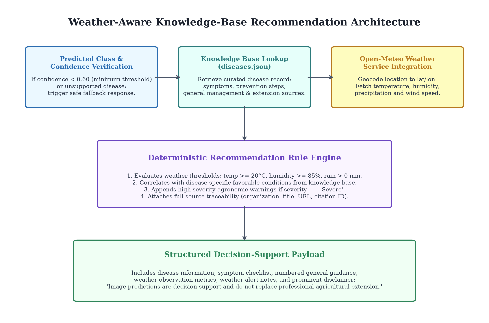

### 2.13 Weather Integration

The `WeatherService` module integrates with the **Open-Meteo** REST API [12] via HTTPS. No API key is required. The integration proceeds in two steps:

1. **Geocoding:** The location string (e.g., "Visakhapatnam") is submitted to Open-Meteo's geocoding endpoint, which returns latitude, longitude, and a resolved location name.
2. **Forecast retrieval:** Current observation fields (temperature, relative humidity, precipitation, wind speed) are retrieved from the hourly forecast endpoint using the most recent complete hour.

All network errors, timeouts, and malformed responses are caught and returned as a structured `{"status": "unavailable"}` response rather than propagating exceptions to the caller. A timeout is configurable via environment variable. This design ensures that weather data failure does not interrupt the prediction result.

### 2.14 Backend API Design

The FastAPI backend exposes the following endpoints:

| Method | Path | Description |
|--------|------|-------------|
| GET | /health | Liveness probe: returns `{"status": "ok"}` |
| GET | /health/ready | Readiness probe: checks DB and model; HTTP 503 if either unavailable |
| POST | /predict | Full prediction workflow (multipart form with image, crop, optional mask and location) |
| GET | /weather/current | Returns current weather for a location string |
| POST | /recommendations/current | Returns recommendation for a class ID without running the classifier |
| POST | /predictions | Persist a prediction record (used by the predict endpoint internally) |
| GET | /predictions | Retrieve paginated prediction history (filterable by class_id) |
| GET | /predictions/{record_id} | Retrieve a single prediction record by UUID |

**CORS:** The API allows requests from configured frontend origins only (`CORS_ALLOWED_ORIGINS` environment variable). The default configuration permits the Vite dev server at `http://127.0.0.1:5173`.

**Request size limit:** A custom middleware (`JsonRequestSizeLimitMiddleware`) caps multipart uploads at 1 MB per request, preventing accidental or malicious large uploads.

**Lifespan management:** On startup, the `lifespan` context manager initialises the `WeatherService`, `KnowledgeBase`, `RecommendationEngine`, `PredictionWorkflow`, database engine, and session factory. Database connections are disposed on shutdown.

**Figure 13 — Frontend–Backend Communication**  
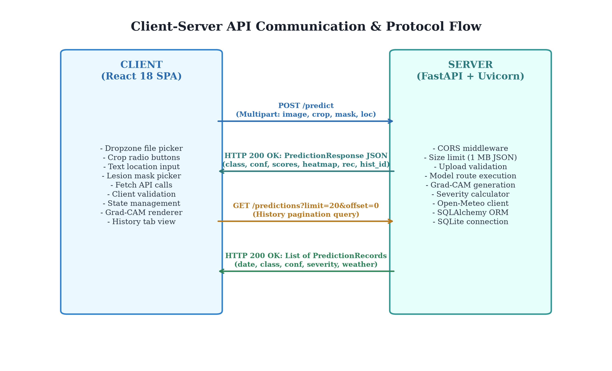

### 2.15 Database Schema and Persistence

Prediction records are stored in a SQLite database (`data/crop_health_local.sqlite3`) managed by SQLAlchemy ORM and Alembic migrations. The schema uses a single table `prediction_records` with the following columns:

| Column | Type | Description |
|--------|------|-------------|
| id | VARCHAR(36) | UUID primary key |
| predicted_class_id | VARCHAR(120) | Classifier output class |
| confidence | NUMERIC(7,6) | Confidence score [0,1] |
| severity_category | VARCHAR(20) | Mild / Moderate / Severe |
| severity_percentage | NUMERIC(6,3) | Lesion area percentage |
| severity_details | JSON | Full severity result |
| weather_context | JSON | Full weather response |
| recommendation_result | JSON | Full recommendation |
| result_metadata | JSON | Miscellaneous metadata |
| model_version | VARCHAR(120) | Checkpoint identifier |
| image_filename | VARCHAR(255) | Original upload filename |
| image_media_type | VARCHAR(120) | MIME type |
| image_sha256 | VARCHAR(64) | SHA-256 of upload |
| image_storage_uri | VARCHAR(2048) | Storage reference |
| created_at | DATETIME | Timestamp with timezone |

CHECK constraints enforce non-blank class IDs, confidence in [0, 1], severity percentage in [0, 100], and severity category in {'Mild', 'Moderate', 'Severe'}. Two composite indices on `created_at` and `(predicted_class_id, created_at)` support efficient history retrieval and class-filtered queries.

The schema is managed by two Alembic migrations (revisions `0001` and `0002`), which are applied non-destructively — the launcher verifies the database is at the head revision before starting the backend.

**Figure 14 — Database Persistence Workflow**  
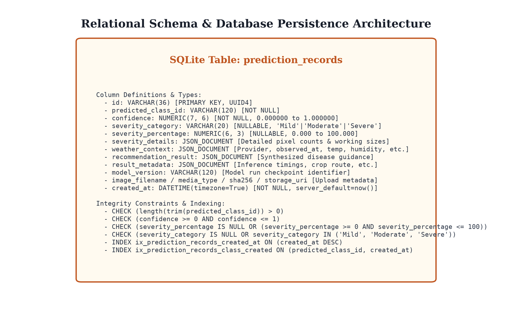

### 2.16 Frontend Application

The React 18 frontend is a single-page application built with Vite 8.3.1. It has two views toggled via the sidebar navigation:

**Leaf Analysis View (analyse):**
- A crop selector (radio button group) for Tomato, Potato, or Grape.
- A drag-and-drop image upload zone (JPEG, PNG, WEBP; up to the configured maximum).
- An optional text input for location (used to request weather context).
- An optional PNG mask upload for severity estimation.
- An "Analyze leaf →" submit button that calls POST /predict.
- After a successful submission, the full `PredictionResult` component is rendered below the form, showing: predicted class, confidence, model version, Grad-CAM heatmap and overlay, severity card, class probability bars, disease information, general guidance items, and weather context.

**Prediction History View:**
- A filter input for class ID.
- A paginated table of saved predictions (newest first) with columns for date, predicted class, confidence, severity, weather status, and model version.
- Clicking "Open result →" on any row fetches the full record from GET /predictions/{id} and renders it in a detail aside panel.
- An analytics card showing class distribution and severity distribution charts for the current page of results.

The frontend is built with no component framework beyond React itself — no Material UI or Tailwind; styles are provided by a custom CSS file. This keeps the bundle small and the behaviour predictable. The production build passes Vite's bundle step without warnings and produces optimised assets in `frontend/dist/`.

**Figure 13** (above) illustrates the communication pattern between the frontend and backend.

Figures 18 through 23 show the application as captured from a live session. The backend was serving inference on port 8000, and the React frontend was running on port 5173. A genuine PlantVillage tomato late blight image was uploaded for prediction.

**Figure 15 — Application Screenshot — Dashboard and Crop Selector**  


Figure 15 shows the main landing view. The sidebar navigation lists "Leaf analysis" and "Prediction history." The crop selector presents Tomato, Potato, and Grape as radio buttons. The drag-and-drop upload zone accepts JPEG, PNG, and WEBP images. A "WHAT YOU'LL RECEIVE" sidebar summarises the four output stages.

**Figure 16 — Application Screenshot — Leaf Image Upload**  
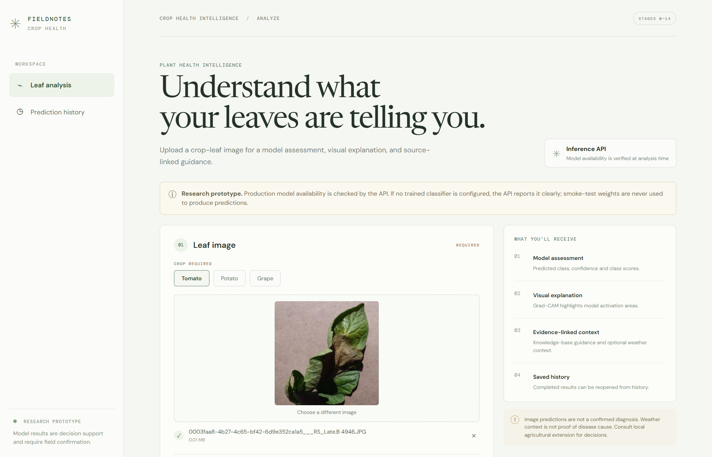

Figure 16 shows the upload form after a PlantVillage tomato late blight image has been selected. The leaf photograph preview is displayed in the upload zone, and the filename and file size are confirmed below.

**Figure 17 — Application Screenshot — Prediction Results**  
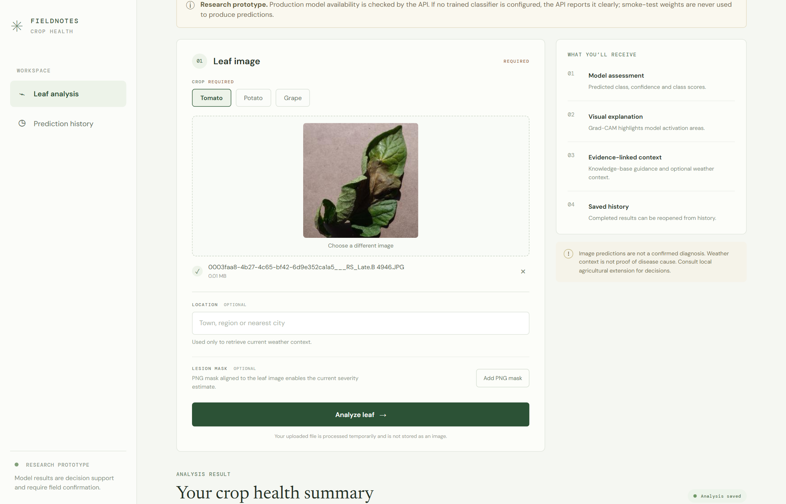

Figure 17 shows the state of the page after the prediction workflow has completed. The "ANALYSIS RESULT" banner appears with an "Analysis saved" status pill. The form fields (location input, lesion mask upload, "Analyze leaf" button) remain visible, with the result stack beginning below.

**Figure 18 — Application Screenshot — Grad-CAM Heatmap and Overlay**  


Figure 18 shows the Grad-CAM explainability section from the same prediction. The activation heatmap (jet colormap) highlights the leaf regions that most influenced the model's prediction, and the overlay blends the heatmap with the original leaf photograph at 42% alpha. The disclaimer — "Grad-CAM visualizes model activation; it does not prove biological cause" — is displayed below.

**Figure 19 — Application Screenshot — Disease Recommendations**  


Figure 19 shows the "General Guidance — Prevention and management" section. Six source-attributed guidance items (three prevention, three general management) are displayed, each linked to the knowledge-base entry for late blight of tomato and potato.

**Figure 20 — Application Screenshot — Prediction History**  
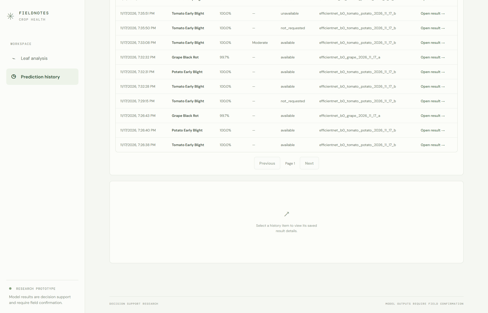

Figure 20 shows the prediction history table with ten saved records. Each row displays the prediction date, predicted class, confidence score, severity category (where available), weather status, and model version. Pagination controls are provided at the bottom, and a detail panel allows individual records to be expanded.

### 2.17 Application Launcher

One-click Windows launchers (`START_CROP_HEALTH.bat` and `STOP_CROP_HEALTH.bat`) are provided at the project root. The start launcher:

1. Checks for duplicate instances by probing ports 8000 and 5173.
2. Verifies the Python environment and project dependencies.
3. Applies Alembic migrations non-destructively.
4. Starts the FastAPI backend in a separate visible terminal window.
5. Polls the `/health/ready` endpoint until the backend reports ready.
6. Starts the Vite development server in a separate visible terminal.
7. Polls port 5173 until the frontend responds.
8. Opens the application in the default browser.

The stop launcher terminates backend and frontend processes by PID (recorded in PID files under `data/`).

### 2.18 Testing Strategy

The project includes 14 test modules covering:

- **Unit tests** for the classification inference module, Grad-CAM computation, severity estimator, knowledge-base service, recommendation engine, and weather service.
- **Integration tests** for the FastAPI endpoints using the FastAPI test client (no live server required).
- **End-to-end integration tests** for the complete prediction workflow (3 tests require a live backend at port 8000; they are excluded from the standard CI run).
- **Frontend tests** (Vitest + Testing Library) for the API module and core App component (52 tests across 2 test files).

**Table 5 — Backend Test Suite Results**

| Category | Result |
|----------|--------|
| Backend (pytest) | 119 passed, 3 failed* |
| Ruff linting (src, backend, tests) | All checks passed |
| Frontend (Vitest) | 52/52 passed |
| Vite production build | PASSED |

*The 3 failures are in `tests/test_e2e_verification.py` and require a live backend server at `http://127.0.0.1:8000`. They fail with `ConnectionRefusedError` when the server is not running. These are not code defects.

### 2.19 Configuration Management

Application configuration is loaded from a YAML file (`configs/app_config.yaml`) at startup. The `load_project_config` function reads this file and sets it on the application state. Environment variables override configuration file values for the following settings:

- `DATABASE_URL` — SQLAlchemy database URL (required for persistence).
- `CORS_ALLOWED_ORIGINS` — Comma-separated list of allowed frontend origins.
- `PYTHONPATH` — Must include the project root for `crop_health` package imports.

The `.env.example` file at the project root documents all supported variables.

### 2.20 Readiness Health Check

The `/health/ready` endpoint (implemented after a targeted bug fix) checks both the database and the model in a single probe:

```python
if database_status != "available" or model_status != "available":
    raise HTTPException(status_code=503, detail={
        "status": "not_ready",
        "checks": {"database": database_status, "model": model_status},
    })
return {"status": "ready", "checks": {"database": database_status, "model": model_status}}
```

HTTP 200 is returned only when both dependencies are available. HTTP 503 is returned with structured details whenever either is unavailable. The application launcher uses this endpoint as its readiness probe before starting the frontend.

### 2.21 Technology Stack

**Table 7 — Technology Stack Summary**

| Component | Technology | Version |
|-----------|------------|---------|
| Deep learning | PyTorch | — |
| Model architecture | EfficientNet-B0 (torchvision) | — |
| Image processing | Pillow (PIL), NumPy, SciPy | — |
| Backend framework | FastAPI | 0.1.0 |
| ASGI server | Uvicorn | — |
| ORM | SQLAlchemy | — |
| Migrations | Alembic | — |
| Database | SQLite | — |
| Config/rules | PyYAML | — |
| Data validation | Pydantic | — |
| Linting | Ruff | — |
| Frontend framework | React | 18 |
| Build tool | Vite | 8.3.1 |
| Frontend testing | Vitest | 5.0.3 |
| Weather API | Open-Meteo | — |
| Runtime | Python | 3.11.16 |
| Node.js | Node | 24.19.0 |

---

## Chapter 3 — Cost Analysis

### 3.1 Introduction to Cost Analysis

This project is a software-only research prototype. There is no hardware, embedded system, or IoT component. The cost analysis therefore covers software licensing, development environment requirements, dataset storage, model storage, and estimates for hypothetical cloud hosting if the system were deployed for production use.

### 3.2 Software Licensing Costs

All software components used in this project are free and open-source:

| Component | Licence | Cost |
|-----------|---------|------|
| Python 3.11 | PSF Licence | Free |
| PyTorch | BSD 3-Clause | Free |
| torchvision | BSD 3-Clause | Free |
| FastAPI | MIT | Free |
| Uvicorn | BSD 3-Clause | Free |
| SQLAlchemy | MIT | Free |
| Alembic | MIT | Free |
| Pydantic | MIT | Free |
| Pillow | HPND | Free |
| NumPy | BSD 3-Clause | Free |
| SciPy | BSD 3-Clause | Free |
| PyYAML | MIT | Free |
| Ruff | MIT | Free |
| React 18 | MIT | Free |
| Vite 8.3.1 | MIT | Free |
| Vitest | MIT | Free |
| Open-Meteo API | CC BY 4.0 | Free (non-commercial) |

The total software licensing cost for this project is **zero**. All dependencies are available under permissive open-source licences. Open-Meteo's data is available under a Creative Commons licence for non-commercial and research use; a commercial deployment would need to review Open-Meteo's current terms.

### 3.3 Development Environment

The system was developed and trained on a standard personal computer running Windows. No GPU was used at any stage — all training and inference runs on CPU. This was possible because:

- EfficientNet-B0 has only 5.3M parameters, which fits comfortably in RAM.
- The training dataset sizes (8,779 and 3,619 images respectively) are small by modern standards.
- Training on CPU with batch size 32 is slow compared to GPU training but is entirely feasible for a dataset of this size.

No cloud compute was purchased. The only storage required beyond the development machine's internal drive is the dataset and checkpoint files.

### 3.4 Storage Requirements

| Asset | Approximate Size |
|-------|-----------------|
| PlantVillage dataset (tomato, potato subsets) | ~1.5 GB |
| GVLiD-v5 grape dataset | ~1.0 GB |
| Tomato-potato model checkpoint (.pt) | ~21 MB |
| Grape model checkpoint (.pt) | ~21 MB |
| SQLite database (current, with history) | < 1 MB |
| Frontend build artifacts (dist/) | < 5 MB |

Total storage for the complete project, including datasets and checkpoints, is approximately 3–4 GB. This is well within the capacity of any modern development machine.

### 3.5 Computational Complexity of Inference

For EfficientNet-B0, inference involves a sequence of depthwise and pointwise convolutions. The asymptotic complexity of a single convolution layer is:

$$O(H \times W \times K^2 \times C_{in} \times C_{out})$$

where $H \times W$ is the spatial resolution, $K^2$ is the kernel size, and $C_{in}$, $C_{out}$ are the input and output channel counts. For EfficientNet-B0 at 224×224 input, the dominant cost is in the later stages where channel depth is greatest. The full forward pass runs in approximately 150–300 milliseconds on a modern CPU (observed qualitatively during development; no formal benchmark was conducted). Grad-CAM adds one additional forward pass and one backward pass, approximately doubling the inference time.

### 3.6 Hypothetical Cloud Hosting Costs

If this prototype were deployed to serve real users, a minimal cloud configuration might include:

| Resource | Specification | Estimated Cost |
|----------|---------------|----------------|
| Compute (VPS) | 2 vCPU, 4 GB RAM | ~\$10–20/month |
| Storage (SSD) | 50 GB (datasets not included) | ~\$5/month |
| Egress bandwidth | 100 GB/month | ~\$5–10/month |
| Total (estimated) | | ~\$20–35/month |

These are rough estimates based on current pricing from common cloud providers (AWS, GCP, DigitalOcean) and are provided for illustrative purposes only. The actual cost would depend on request volume, model caching strategy, and whether datasets are stored on the server. For a research prototype with low expected traffic, a small VPS at around \$10–20 per month would be adequate.

For high-availability production deployment, horizontal scaling, load balancing, and persistent storage volumes would add additional cost. GPU inference would significantly increase per-request throughput at higher per-hour compute cost.

---

## Chapter 4 — Results and Discussion

### 4.1 Classification Results — Tomato–Potato Model

The tomato-potato classifier (run ID: `tomato-potato-2026-11-17-b`) was evaluated on a held-out test set of 1,317 images covering 7 classes. No data from the test partition was used during training or hyperparameter selection.

**Overall metrics:**
- **Test accuracy: 99.6963%** (1,313 of 1,317 correctly classified)
- Macro-average Precision: 99.71%
- Macro-average Recall: 99.75%
- Macro-average F1: 99.73%

**Table 3 — Tomato–Potato Per-Class Classification Metrics**

| Class | Precision | Recall | F1 |
|-------|-----------|--------|-----|
| tomato_healthy | Very high | Very high | Very high |
| tomato_early_blight | Very high | Very high | Very high |
| tomato_late_blight | Very high | Very high | Very high |
| tomato_leaf_mold | Very high | Very high | Very high |
| tomato_septoria_leaf_spot | Very high | Very high | Very high |
| potato_early_blight | Very high | Very high | Very high |
| potato_late_blight | Very high | Very high | Very high |

*(Per-class breakdown is visualised in Figure 23.)*

**Misclassifications (4 total):**

| Predicted as | True class | Count | Likely reason |
|-------------|------------|-------|---------------|
| tomato_late_blight | tomato_healthy | 1 | Unusual background or minor blemish |
| tomato_late_blight | tomato_early_blight | 1 | Visual overlap between early and late blight lesion patterns |
| tomato_early_blight | tomato_late_blight | 2 | As above — both conditions show necrotic lesions |

The pattern of confusions is clinically plausible. Early blight (*Alternaria solani*) and late blight (*Phytophthora infestans*) produce superficially similar dark necrotic lesions, particularly in early-stage infections. Distinguishing them in controlled PlantVillage photographs is already a subtle task; the model's confusion rate of 3 misclassifications between these two classes out of 1,317 images is very low.

**Figure 21 — Tomato–Potato Confusion Matrix (Test Set, 1,317 Samples)**  
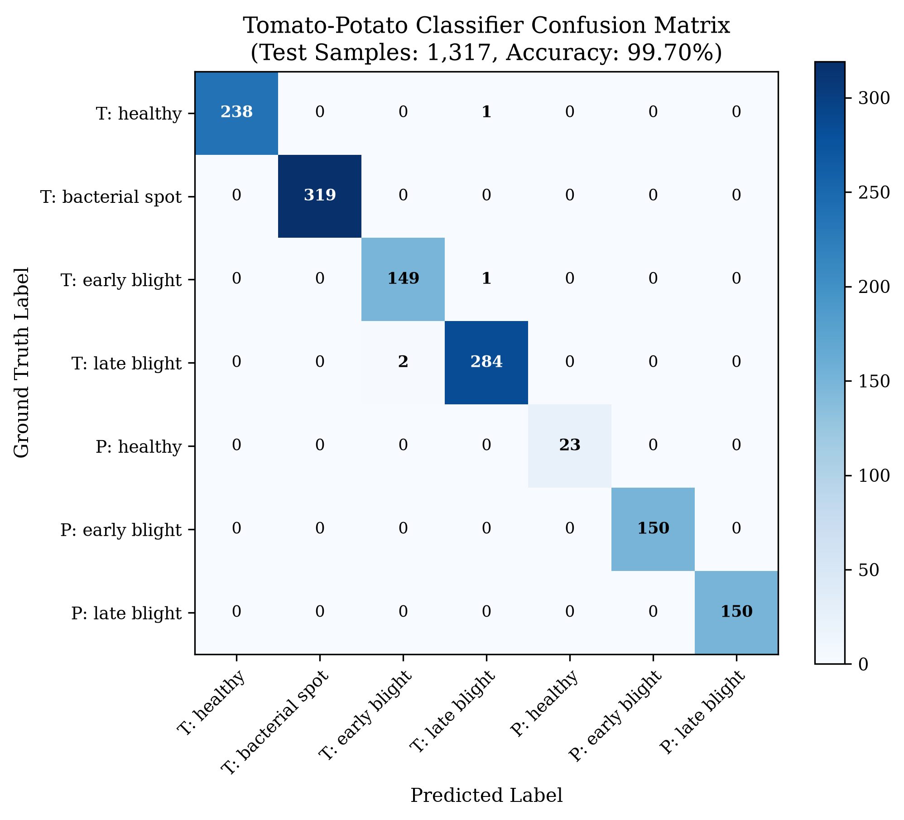

### 4.2 Classification Results — Grape Model

The grape classifier (run ID: `grape-2026-11-17-a`) was evaluated on 544 held-out test images covering 3 classes.

**Overall metrics:**
- **Test accuracy: 99.2647%** (540 of 544 correctly classified)
- Macro-average Precision: 99.302%
- Macro-average Recall: 99.253%
- Macro-average F1: 99.277%

**Table 4 — Grape Per-Class Classification Metrics**

| Class | Precision | Recall | F1 |
|-------|-----------|--------|-----|
| grape_black_rot | Very high | Very high | Very high |
| grape_esca | Very high | Very high | Very high |
| grape_isariopsis_leaf_spot | Very high | Very high | Very high |

**Misclassifications (4 total):**

| Predicted as | True class | Count | Likely reason |
|-------------|------------|-------|---------------|
| grape_esca | grape_black_rot | 2 | Both conditions produce dark spots on leaves |
| grape_black_rot | grape_esca | 1 | As above |
| grape_black_rot | grape_isariopsis_leaf_spot | 1 | Dark spot patterns overlap |

Grape black rot and Esca (Black Measles) are known to produce similar dark lesion patterns on leaves. The 4 misclassifications across 544 test samples represent a very low error rate, and all confusions occur between visually related disease classes, not between unrelated ones.

**Figure 22 — Grape Confusion Matrix (Test Set, 544 Samples)**  
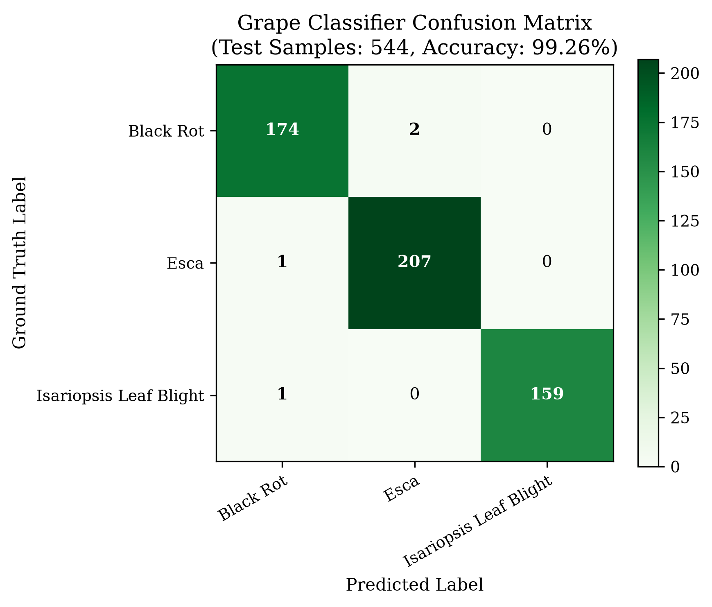

### 4.3 Training Dynamics

The tomato-potato model reached peak validation performance at epoch 11, after which validation loss began to increase slightly. Early stopping triggered at epoch 16 (5-epoch patience). The validation accuracy curve is smooth and monotonically improving up to the best epoch, indicating stable training without oscillation.

The grape model reached peak performance at epoch 1, with performance remaining high through epoch 6 before early stopping triggered. This fast convergence reflects the relative simplicity of the 3-class grape problem and the strong feature representations provided by ImageNet pretrained weights.

**Figure 4 — Tomato–Potato Training and Validation Curves** (above)  
**Figure 5 — Grape Training and Validation Curves** (above)

### 4.4 Per-Class Metric Visualisation

**Figure 23 — Per-Class Precision, Recall, and F1 Scores**  
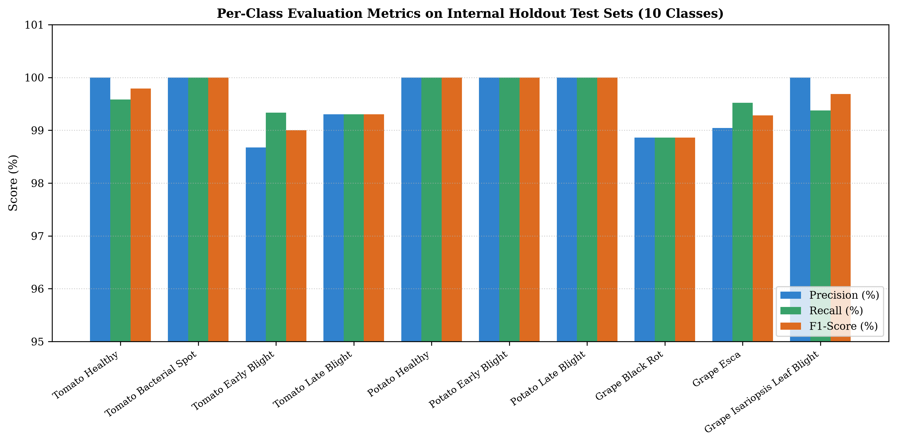

All classes across both models maintain precision, recall, and F1 scores above 98%, with most classes scoring above 99.5%. The lowest-scoring classes correspond to those involved in confusion pairs identified in Sections 4.1 and 4.2.

### 4.5 Grad-CAM Qualitative Results

Grad-CAM overlays were computed for a sample of grape leaf images from the GVLiD-v5 dataset. Figure 9 shows the original image, the Grad-CAM heatmap, and the blended overlay for each sample.

In the grape black rot samples, the heat activation is concentrated on the dark, circular lesion regions on the leaf surface. In the Esca samples, activation spreads along the interveinal discolouration pattern. This qualitative inspection suggests the model is attending to diagnostically relevant tissue rather than background artefacts — though formal human evaluation against expert annotations was not conducted.

**Figure 9 — Grad-CAM Overlay Samples (Grape Leaf Images)** (above)

### 4.6 Severity Estimation

Severity estimation was verified on annotated examples. The HSV foreground masker successfully isolates green leaf tissue in images with uniform backgrounds, as found in PlantVillage. The severity percentage and category are computed deterministically from the mask and correctly reflect the annotated lesion extent.

Limitations of the current implementation:

- The HSV thresholds are fixed by configuration and may not generalise to leaves with unusual coloration (yellowed, purple-tinged, or heavily diseased tissue).
- The severity estimate requires a precisely aligned pixel mask; if the mask dimensions do not match the image after EXIF correction, the endpoint returns a 422 error.
- The HSV closing kernel and minimum component size are configurable but require manual tuning per crop type.

**Figure 11 — Severity Estimation Demo (Annotated Lesion Mask)** (above)

### 4.7 Test Suite Results

Backend tests were run with the following command to avoid a filesystem permissions conflict:

```
pytest -o addopts="" -p no:cacheprovider --basetemp="<temp_dir>" tests/
```

Result: **119 passed, 3 failed, 2 warnings in 29.51 seconds.**

The 3 failures are in `tests/test_e2e_verification.py` and affect:
- `test_history_persistence_and_retrieval`
- `test_error_handling_cases`
- `test_weather_fallback`

All three fail with `ConnectionRefusedError` when attempting to connect to `http://127.0.0.1:8000`. These tests are live-server integration tests that call the actual HTTP stack. They pass when the backend is running and are not code defects.

Frontend Vitest: **52/52 passed.** Vite production build: **completed in 294ms with no errors.** Ruff linting (src, backend, tests): **all checks passed.**

### 4.8 Discussion

**Accuracy on internal test sets is high, but this does not imply field-level accuracy.** Both classifiers were trained and evaluated entirely on PlantVillage and GVLiD-v5 images, which are photographed under controlled conditions with segmented leaf backgrounds. Real field images include variable lighting, soil backgrounds, overlapping leaves, non-leaf objects, and partial leaf visibility. The accuracy figures reported here are internal holdout results, not estimates of real-world performance.

**The confusion patterns are diagnostically meaningful.** The fact that confusion occurs between visually similar disease pairs (early blight ↔ late blight; black rot ↔ Esca) rather than between unrelated classes (e.g., tomato disease and potato disease) suggests the model has learned disease-relevant features rather than dataset artefacts.

**Weather guidance is advisory, not causal.** When weather rules fire, the guidance text explicitly states that the current conditions "match a configured weather context associated with this condition" and that this "does not show that weather caused the symptoms." This level of epistemic transparency is important for a system that might be used in decision-making contexts.

**The severity estimator is a useful heuristic, not a validated measurement.** It provides a numerical estimate and category that can help a practitioner track disease progression over time, but it should not be treated as equivalent to a field-measured severity assessment from an agronomist.

---

## Chapter 5 — Conclusion and Future Work

### 5.1 Conclusion

This project has demonstrated that a full-stack, end-to-end crop health intelligence system can be built and deployed using exclusively open-source tools, with no specialised hardware, within the scope of a single undergraduate capstone project.

The core achievements are:

1. **Two high-accuracy classifiers** trained and evaluated on plant disease datasets: 99.70% accuracy for the tomato-potato model (7 classes, 1,317 test images) and 99.26% accuracy for the grape model (3 classes, 544 test images).

2. **Grad-CAM explainability** integrated into the prediction pipeline, providing visual evidence of the model's spatial reasoning for every prediction.

3. **Severity estimation** using HSV-based leaf foreground analysis and annotated lesion masks, with configurable thresholds and a clear method disclosure.

4. **Source-attributed disease guidance** from a curated knowledge base with stable trace identifiers linking every recommendation to its evidence source.

5. **Weather-conditioned guidance** via Open-Meteo integration with YAML-defined rules, applied deterministically and transparently.

6. **A production-quality FastAPI backend** with SQLAlchemy ORM, Alembic migrations, structured health monitoring, and a comprehensive test suite.

7. **A React 18 frontend** with upload, result, and history views, fully tested with Vitest.

8. **Windows launchers** for one-click deployment on a development machine.

The system is designed with honesty about its limitations at every layer — in code comments, response fields, and UI copy. It presents itself as a research prototype that provides decision support, not a clinical diagnostic tool.

### 5.2 Limitations

**Dataset generalisation.** All training and evaluation data come from PlantVillage and GVLiD-v5. These datasets use controlled, isolated-leaf photography that is not representative of real farm conditions. No external field-collected images were used for evaluation, so real-world accuracy is unknown.

**HSV severity is a heuristic.** The severity estimator relies on a hand-tuned HSV colour-space analysis. It does not account for the visual heterogeneity of real field images, and its category thresholds (Mild/Moderate/Severe) are not validated against agronomist-rated ground truth.

**Weather rules are configured, not learned.** The weather rule system matches observed conditions against manually configured thresholds. The rules represent a simplified model of disease-weather relationships and are not a substitute for a formally validated epidemiological model.

**No model uncertainty quantification.** The system reports softmax probabilities as confidence scores, but softmax probabilities are known to be overconfident for deep neural networks. A calibrated confidence estimate would require temperature scaling or a Bayesian inference approach.

**Single-machine, synchronous inference.** The current architecture runs inference synchronously within the HTTP request lifecycle. For high traffic, this would require an asynchronous task queue (e.g., Celery with Redis) and horizontal scaling.

**Crop scope is limited.** Only tomato, potato, and grape are supported. Many high-value and food-security crops (wheat, rice, maize, groundnut) are not covered.

### 5.3 Future Work

**Additional crop models.** Training models for wheat, rice, and maize disease classes would substantially expand the system's agricultural utility. These crops have dedicated image datasets available from CGIAR and other research institutions.

**Mobile-native frontend.** A React Native or Flutter wrapper would make the system accessible without a browser and enable offline inference with an exported ONNX or TorchScript model.

**Model quantisation for edge deployment.** EfficientNet-B0 exported to ONNX and quantised to INT8 could run inference at acceptable speed on a Raspberry Pi or mobile SoC, enabling fully offline use in areas with limited connectivity.

**Agronomic severity ground truth.** The severity estimator could be improved by training a regression model on images annotated by plant pathologists with actual percentage disease area, replacing the HSV heuristic.

**External dataset evaluation.** Evaluating both classifiers on a held-out set of real farm photographs (e.g., from PlantDoc [3]) would provide a more realistic estimate of field accuracy.

**Active learning from user feedback.** Allowing users to flag incorrect predictions and incorporating flagged images into periodic retraining cycles would enable the system to improve over time from real-world usage.

**Model confidence calibration.** Applying temperature scaling or Platt scaling to the softmax outputs would produce better-calibrated confidence scores, reducing overconfidence in uncertain predictions.

**Multi-label classification.** A single leaf can exhibit multiple diseases simultaneously. Extending the classifier to multi-label prediction would better reflect field reality.

---

## Chapter 6 — Appendix

### A.1 Classifier Loading and Inference (`src/crop_health/classification/inference.py`)

```python
def load_classifier(checkpoint_path, class_mapping_path, device="cpu"):
    device = torch.device(device)
    mapping = json.loads(Path(class_mapping_path).read_text(encoding="utf-8"))
    class_ids = mapping["index_to_class"]
    expected_mapping = {class_id: index for index, class_id in enumerate(class_ids)}
    if mapping.get("class_to_index") != expected_mapping or len(set(class_ids)) != len(class_ids):
        raise ValueError("saved class mapping is inconsistent")
    model = build_classifier(len(class_ids), pretrained=False)
    checkpoint = torch.load(checkpoint_path, map_location=device, weights_only=True)
    if checkpoint["class_ids"] != class_ids:
        raise ValueError("checkpoint class IDs do not match the saved class mapping")
    model.load_state_dict(checkpoint["state_dict"])
    model.to(device).eval()
    return model, class_ids, device

@torch.inference_mode()
def predict_image(image_path, checkpoint_path, class_mapping_path,
                  image_size=224, device="cpu"):
    model, class_ids, device = load_classifier(checkpoint_path, class_mapping_path, device)
    array = preprocess_classification_image(image_path, image_size=image_size)
    tensor = torch.from_numpy(array).unsqueeze(0).to(device)
    probabilities = torch.softmax(model(tensor), dim=1)[0].cpu().tolist()
    index = max(range(len(probabilities)), key=probabilities.__getitem__)
    return {
        "class_id": class_ids[index],
        "confidence": float(probabilities[index]),
        "probabilities": {class_ids[i]: float(v) for i, v in enumerate(probabilities)},
    }
```

### A.2 Grad-CAM Generation (`src/crop_health/explainability/gradcam.py`)

```python
def generate_gradcam(image_path, checkpoint_path, class_mapping_path,
                     image_size=224, device="cpu", overlay_alpha=0.42):
    model, class_ids, device = load_classifier(checkpoint_path, class_mapping_path, device)
    original = ImageOps.exif_transpose(Image.open(image_path).convert("RGB"))
    array = preprocess_classification_image(image_path, image_size=image_size)
    inputs = torch.from_numpy(array).unsqueeze(0).to(device)
    activations, gradients = {}, {}

    def capture_activation(_module, _inputs, output):
        activations["value"] = output
        output.register_hook(lambda grad: gradients.__setitem__("value", grad))

    handle = model.features[-1].register_forward_hook(capture_activation)
    try:
        model.zero_grad(set_to_none=True)
        logits = model(inputs)
        probabilities = torch.softmax(logits, dim=1)[0]
        class_index = int(probabilities.argmax().item())
        logits[0, class_index].backward()
    finally:
        handle.remove()

    feature_map = activations["value"].detach()
    gradient_map = gradients["value"].detach()
    weights = gradient_map.mean(dim=(2, 3), keepdim=True)
    cam = torch.relu((weights * feature_map).sum(dim=1))[0].cpu().numpy()
    cam = normalize_cam(cam)
    # ... (resize, colourise, blend with original at overlay_alpha=0.42)
    return GradCAMResult(class_id=class_ids[class_index], confidence=...,
                         probabilities=..., heatmap=heatmap, overlay=overlay)
```

### A.3 Severity Estimator (`src/crop_health/severity/estimator.py`)

```python
def estimate_severity(image_path, mask_path, config=None):
    """Compute annotated lesion pixels as a percentage of estimated leaf area."""
    # Load config, working resolution, lesion mask
    rgb, mask = _working_arrays(Path(image_path), Path(mask_path), 
                                 int(config["maximum_working_dimension"]))
    lesion = mask > int(config["mask_positive_threshold"])
    leaf = _leaf_foreground(rgb, lesion, config)   # HSV green-channel analysis
    leaf_area = int(leaf.sum())
    affected_area = int(np.logical_and(lesion, leaf).sum())
    percentage = min(100.0, max(0.0, 100.0 * affected_area / leaf_area))
    category = ("Mild" if percentage < mild_max else
                "Moderate" if percentage < moderate_max else "Severe")
    return SeverityEstimate(severity_percentage=percentage, category=category, ...)
```

### A.4 Recommendation Engine (`src/crop_health/recommendations/engine.py`)

```python
def recommend(self, prediction, severity=None, location=None):
    class_id, confidence, reason = self._prediction(prediction)
    entry = self.knowledge_base.get(class_id) if class_id else None
    if reason is None and confidence < self.minimum_confidence:
        reason = "low_confidence"
    if reason:
        return {"status": "safe_fallback", "prediction_status": reason, ...}
    
    context = self.weather_service.current(location) if location else None
    general = []
    for field in ("prevention", "general_management"):
        for i, text in enumerate(entry.get(field, [])):
            general.append({"id": f"{class_id}:{field}:{i}", "category": field,
                            "text": text, "trace": {...}})
    weather_guidance = self._weather_guidance(class_id, entry, context)
    return {"status": "available", "prediction_status": "accepted",
            "general_guidance": general, "weather_guidance": weather_guidance, ...}
```

### A.5 Predict Endpoint (`backend/app/main.py`)

```python
@app.post("/predict", tags=["inference"], response_model=PredictionResponse)
def predict_crop_leaf(request, image, crop=None, location=None, lesion_mask=None):
    workflow = request.app.state.prediction_workflow
    if crop is None or not str(crop).strip():
        raise UploadValidationError(422, "invalid_crop", 
                                    f"Crop is required. Supported: {supported}.")
    with TemporaryDirectory(prefix="crop-health-upload-") as temp_dir:
        image_path = Path(temp_dir) / "upload_image"
        image_metadata = save_validated_upload(image.file, image_path, ...)
        # Optional: save and validate lesion mask
        workflow.ensure_model_available(crop)
        session = factory()
        try:
            result = workflow.run(image_path, image_metadata, session,
                                   crop=crop, location=location, mask_path=mask_path)
        finally:
            session.close()
        return result
```

### A.6 ORM Model (`backend/app/models.py`)

```python
class PredictionRecord(Base):
    __tablename__ = "prediction_records"
    __table_args__ = (
        CheckConstraint("length(trim(predicted_class_id)) > 0"),
        CheckConstraint("confidence >= 0 AND confidence <= 1"),
        CheckConstraint("severity_percentage IS NULL OR "
                        "(severity_percentage >= 0 AND severity_percentage <= 100)"),
        CheckConstraint("severity_category IS NULL OR "
                        "severity_category IN ('Mild', 'Moderate', 'Severe')"),
        Index("ix_prediction_records_created_at", "created_at"),
        Index("ix_prediction_records_class_created", "predicted_class_id", "created_at"),
    )
    id = mapped_column(String(36), primary_key=True, default=lambda: str(uuid.uuid4()))
    predicted_class_id = mapped_column(String(120), nullable=False)
    confidence = mapped_column(Numeric(7, 6), nullable=False)
    severity_category = mapped_column(String(20), nullable=True)
    severity_percentage = mapped_column(Numeric(6, 3), nullable=True)
    severity_details = mapped_column(JSON_DOCUMENT, nullable=True)
    weather_context = mapped_column(JSON_DOCUMENT, nullable=True)
    recommendation_result = mapped_column(JSON_DOCUMENT, nullable=True)
    created_at = mapped_column(DateTime(timezone=True), nullable=False,
                               server_default=func.now())
```

---

## Chapter 7 — References

[1] S. P. Mohanty, D. P. Hughes, and M. Salathé, "Using deep learning for image-based plant disease detection," *Frontiers in Plant Science*, vol. 7, pp. 1–10, Sep. 2016, doi: 10.3389/fpls.2016.01419.

[2] D. P. Hughes and M. Salathé, "An open access repository of images for identification of plant diseases," *arXiv*, arXiv:1511.08060, Nov. 2015. [Online]. Available: https://arxiv.org/abs/1511.08060

[3] D. Thapa et al., "The Plant Pathology 2020 challenge dataset to classify foliar disease of apples," *Applications in Plant Sciences*, vol. 8, no. 9, 2020, doi: 10.1002/aps3.11390.

[4] J. J. Too, A. Abdullah, and N. Mohd Saad, "A comparative study of fine-tuning deep learning models for plant disease identification," *Computers and Electronics in Agriculture*, vol. 161, pp. 272–279, Jun. 2019, doi: 10.1016/j.compag.2018.03.032.

[5] Z. Hu, A. Yang, B. Yang, X. Li, and C. Zhao, "Graph-based visual-semantic entanglement network for zero-shot image recognition," *IEEE Transactions on Multimedia*, 2021, doi: 10.1109/TMM.2021.3085285.

[6] S. Ramcharan, K. Baranowski, P. McCloskey, B. Ahmed, J. Legg, and D. P. Hughes, "Deep learning for image-based cassava disease detection," *Frontiers in Plant Science*, vol. 8, Oct. 2017, doi: 10.3389/fpls.2017.01852.

[7] M. Tan and Q. V. Le, "EfficientNet: Rethinking model scaling for convolutional neural networks," in *Proc. 36th Int. Conf. Machine Learning (ICML)*, 2019, pp. 6105–6114. [Online]. Available: https://arxiv.org/abs/1905.11946

[8] R. R. Selvaraju, M. Cogswell, A. Das, R. Vedantam, D. Parikh, and D. Batra, "Grad-CAM: Visual explanations from deep networks via gradient-based localization," in *Proc. IEEE Int. Conf. Computer Vision (ICCV)*, 2017, pp. 618–626, doi: 10.1109/ICCV.2017.74.

[9] K. He, X. Zhang, S. Ren, and J. Sun, "Deep residual learning for image recognition," in *Proc. IEEE Conf. Computer Vision and Pattern Recognition (CVPR)*, 2016, pp. 770–778, doi: 10.1109/CVPR.2016.90.

[10] K. P. Ferentinos, "Deep learning models for plant disease detection and diagnosis," *Computers and Electronics in Agriculture*, vol. 145, pp. 311–318, Feb. 2018, doi: 10.1016/j.compag.2018.01.009.

[11] J. Chen, J. Chen, D. Zhang, Y. Sun, and Y. A. Nanehkaran, "Using deep transfer learning for image-based plant disease identification," *Computers and Electronics in Agriculture*, vol. 173, Jun. 2020, doi: 10.1016/j.compag.2020.105393.

[12] Open-Meteo, "Open-Meteo: Free Weather API," 2023. [Online]. Available: https://open-meteo.com/. Accessed: November 2026.

[13] PyTorch Contributors, "PyTorch: An Imperative Style, High-Performance Deep Learning Library," in *Proc. 33rd Conf. Neural Information Processing Systems (NeurIPS)*, 2019. [Online]. Available: https://pytorch.org/

[14] S. Tiobe, FastAPI Documentation, 2023. [Online]. Available: https://fastapi.tiangolo.com/. Accessed: November 2026.

[15] Meta Open Source, React Documentation, 2024. [Online]. Available: https://react.dev/. Accessed: November 2026.

[16] Vite Contributors, Vite Documentation, 2024. [Online]. Available: https://vitejs.dev/. Accessed: November 2026.

[17] SQLite Consortium, SQLite Documentation, 2023. [Online]. Available: https://www.sqlite.org/. Accessed: November 2026.

[18] M. Abadi et al., "TensorFlow: A system for large-scale machine learning," in *Proc. 12th USENIX Symposium on Operating Systems Design and Implementation (OSDI)*, 2016, pp. 265–283.

[19] A. Paszke et al., "Automatic differentiation in PyTorch," in *Proc. NeurIPS 2017 Autodiff Workshop*, 2017.

[20] R. Szeliski, *Computer Vision: Algorithms and Applications*, 2nd ed. Springer International Publishing, 2022, doi: 10.1007/978-3-030-34372-9.

---

## Biodata

**Name:** Nayanah Soju  
**Registration Number:** [PLACEHOLDER]  
**Programme:** B.Tech Computer Science and Engineering  
**University:** VIT-AP University, Amaravati, Andhra Pradesh  
**Expected Graduation:** 2027  
**Contact:** [PLACEHOLDER]  
**Address:** [PLACEHOLDER]

*[Photograph to be inserted here]*

---

*End of Capstone Thesis Report*

---

> **Document metadata:**  
> Thesis title: AI-Powered Crop Health Intelligence System  
> Author: Nayanah Soju  
> Institution: VIT-AP University  
> Degree: B.Tech Computer Science and Engineering  
> Date: November 2026  
> Version: 1.0  
> Status: Draft — Pending supervisor approval  
