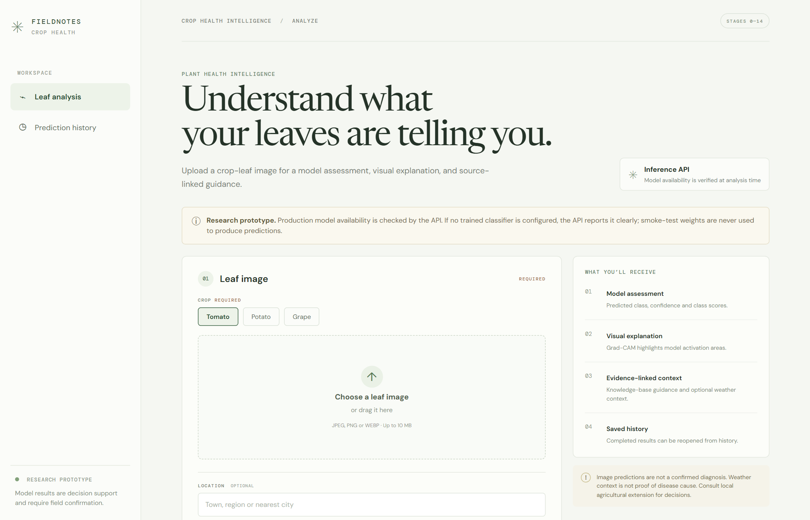
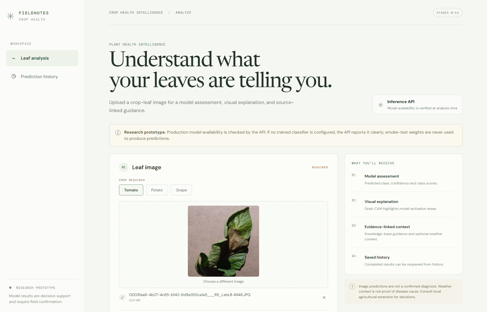
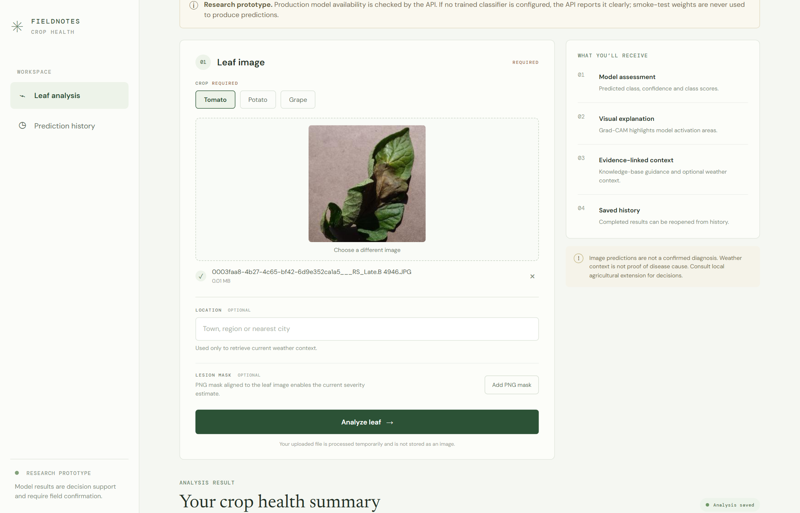
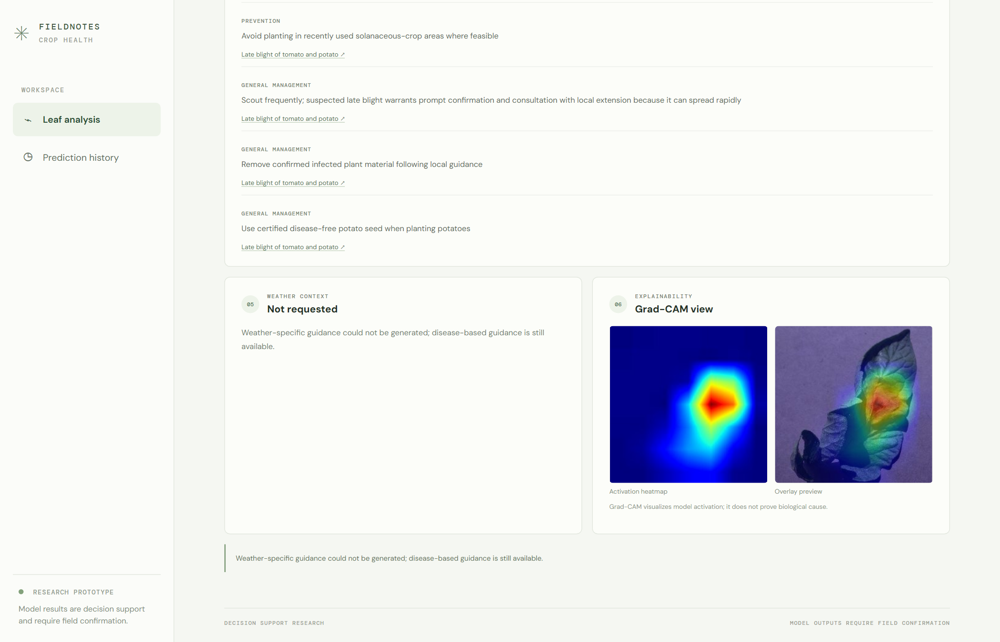
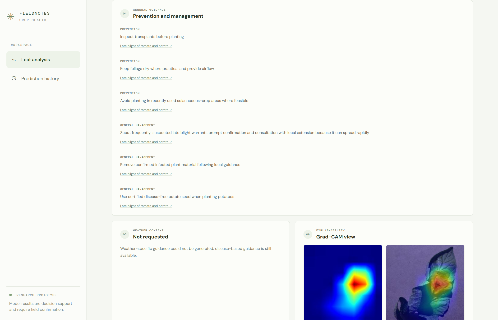
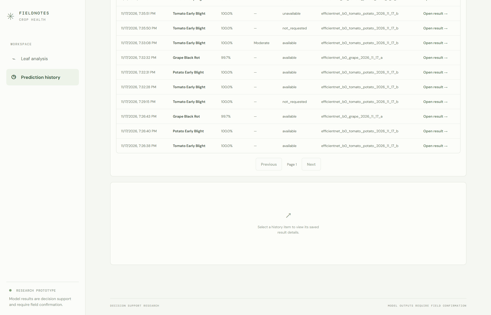
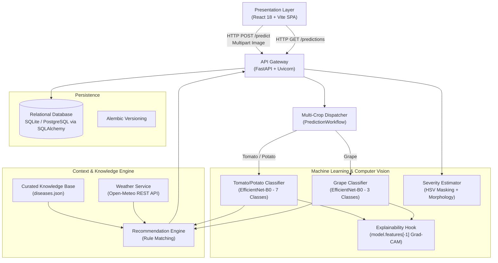

# AI-Powered Crop Health Intelligence System

An end-to-end intelligent agricultural decision-support system that combines deep convolutional neural network classification, Grad-CAM visual explainability, classical lesion-mask severity estimation, a curated agronomic knowledge base, real-time weather context, and a persistent prediction history into an accessible web application.

Developed as a B.Tech Capstone Project at **VIT-AP University**, School of Computer Science and Engineering.

---

## System Overview

Manual visual inspection of crop leaves is slow, subjective, and limited by the scarcity of plant pathologists in rural areas. This system addresses this diagnostic gap by providing:

1. **Multi-Crop Deep Learning Classification:** Independently trained and fine-tuned EfficientNet-B0 architectures for Tomato, Potato, and Grape leaf diseases.
2. **Visual Model Explainability (Grad-CAM):** Gradient-weighted Class Activation Mapping highlighting the exact spatial regions of the leaf that influenced the model's prediction.
3. **Classical Severity Estimation:** HSV green-channel thresholding and morphological closing calculating percentage lesion area from co-registered pixel masks.
4. **Source-Traceable Agronomic Guidance:** Curated disease knowledge base providing symptom lists, prevention strategies, and chemical/cultural management recommendations with direct bibliographic links.
5. **Contextual Weather Awareness:** Integration with the Open-Meteo REST API evaluating current local temperature, relative humidity, precipitation, and wind against disease-favouring conditions.
6. **Persistent Prediction History:** SQLite database with SQLAlchemy ORM and Alembic migrations tracking historical diagnoses with class-level analytics.
7. **One-Click Windows Launchers:** Automated startup (`START_CROP_HEALTH.bat`) and shutdown (`STOP_CROP_HEALTH.bat`) scripts with automated dependency validation and database migration checks.

---

## Application Screenshots

### 1. Main Dashboard & Crop Selection

*Figure: Web dashboard with navigation sidebar, crop radio selector (Tomato, Potato, Grape), drag-and-drop upload zone, and workflow overview.*

### 2. Leaf Image Upload & Validation

*Figure: Form showing image preview, dimension verification, and file size checks on an uploaded leaf specimen.*

### 3. Real-Time Inference Results

*Figure: Real-time inference output displaying predicted disease class, confidence score, model version, and analysis status.*

### 4. Grad-CAM Explainability View

*Figure: Side-by-side jet activation heatmap and blended leaf overlay displaying model attention regions.*

### 5. Evidence-Linked Guidance & Recommendations

*Figure: Source-attributed prevention and management guidance matched to the predicted pathology.*

### 6. Historical Records & Analytics

*Figure: Paginated history table tracking past diagnoses, confidence levels, weather context, and model versions.*

---

## Architecture



---

## Model Performance & Evaluation

Both models were trained using transfer learning on ImageNet-pretrained **EfficientNet-B0** backbones. Training employed group-aware stratified splits to prevent background leakage between training, validation, and holdout test partitions.

| Metric | Tomato–Potato Model (`tomato-potato-2026-11-17-b`) | Grape Model (`grape-2026-11-17-a`) |
| :--- | :--- | :--- |
| **Test Accuracy** | **99.6963%** (1,313 / 1,317) | **99.2647%** (540 / 544) |
| **Macro Precision** | **99.71%** | **99.30%** |
| **Macro Recall** | **99.75%** | **99.25%** |
| **Macro F1-Score** | **99.73%** | **99.28%** |
| **Holdout Test Samples** | 1,317 images | 544 images |
| **Training Samples** | 6,145 images | 2,531 images |
| **Validation Samples** | 1,317 images | 544 images |
| **Covered Classes** | 7 classes (Early Blight, Late Blight, Leaf Mold, Septoria, Healthy) | 3 classes (Black Rot, Esca, Isariopsis Leaf Spot) |
| **Convergence** | Best Epoch 11 (Early stopped at 16) | Best Epoch 1 (Early stopped at 6) |

*Evaluation note: All evaluations were performed on held-out test splits from PlantVillage and GVLiD-v5. PlantDoc was explicitly excluded from training and evaluation.*

---

## Technology Stack

- **Deep Learning & Computer Vision:** PyTorch, Torchvision (EfficientNet-B0), NumPy, SciPy, Pillow, Matplotlib
- **Backend API:** FastAPI, Uvicorn, Pydantic v2, SQLAlchemy 2.0, Alembic
- **Database:** SQLite (local development / desktop launcher), PostgreSQL-ready ORM schema
- **Frontend SPA:** React 18, Vite 8, CSS3 (Modular / Custom styling, zero heavy UI frameworks)
- **Automated Testing:** Pytest (122 backend tests), Vitest (52 frontend tests), Playwright (E2E browser automation)
- **External Integration:** Open-Meteo Weather API (HTTPS geocoding and hourly weather forecast)
- **Documentation:** Python-docx (automated thesis report compiler), KaTeX, Mermaid

---

## Repository Structure

```
crop-health-intelligence/
├── backend/app/               # FastAPI application, routes, ORM models, prediction workflow
├── frontend/                  # React 18 single-page application (Vite build)
├── src/crop_health/           # Core library: classification, Grad-CAM, severity, weather, KB
├── configs/                   # Application configs, severity thresholds, weather rules
├── alembic/                   # Database migration revisions
├── doc_assets/                # 17 architectural/evaluation figures + 6 live UI screenshots
│   └── screenshots/           # High-resolution genuine UI captures
├── docs/                      # Architectural designs, API specs, deployment guides
├── reports/                   # Integration tests, research gap analyses, thesis quality audits
│   └── thesis/                # Quality audit and screenshot verification reports
├── tests/                     # Comprehensive backend unit and integration test suite
├── scripts/                   # Verification utilities, launchers, quality gates
├── CAPSTONE_THESIS_REPORT.md  # Complete 68-page B.Tech Capstone Thesis in Markdown
├── build_thesis_docx.py       # Script compiling Markdown thesis to formatted DOCX
├── generate_thesis_figures.py # Script generating 300 DPI architecture and evaluation diagrams
├── capture_screenshots.py     # Playwright script automating live application screenshot capture
├── START_CROP_HEALTH.bat      # One-click Windows startup script
├── STOP_CROP_HEALTH.bat       # One-click Windows shutdown script
└── requirements.txt           # Python dependency manifest
```

---

## Quick Start Guide

### Prerequisites
- Windows 10/11, macOS, or Linux
- Python 3.10+ (Python 3.11 recommended)
- Node.js 18+ and npm

### 1. Installation
Clone the repository:
```bash
git clone https://github.com/nayanahsoju-max/crop-health-intelligence.git
cd crop-health-intelligence
```

Set up the Python environment:
```bash
python -m venv .venv
# Windows:
.venv\Scripts\activate
# Linux/macOS:
source .venv/bin/activate

pip install -r requirements.txt
```

Set up the frontend:
```bash
cd frontend
npm install
cd ..
```

### 2. Model Checkpoint Setup & Configuration

Due to GitHub's file size guidelines for Git repositories, binary model weights (`*.pt`) are excluded via `.gitignore`. The application routing configuration (`configs/prediction_config.yaml`) expects the following checkpoint directory structure:

```
models/classifier/runs/
├── tomato-potato-2026-11-17-b/
│   ├── class_mapping.json
│   └── efficientnet_b0_best.pt          # ~21 MB (Tomato/Potato 7-class classifier)
└── grape-2026-11-17-a/
    ├── class_mapping.json
    └── efficientnet_b0_best.pt          # ~21 MB (Grape 3-class classifier)
```

#### Option A: Obtain Pretrained Checkpoints
Download the release assets `efficientnet_b0_best.pt` and their respective `class_mapping.json` from the repository's **Releases** tab and place them into the paths shown above.

#### Option B: Train from Scratch
To train the classifiers using the leakage-safe group-stratified splits:
```bash
# Generate deterministic splits
python scripts/create_leakage_safe_split.py

# Train Tomato/Potato and Grape models (CPU or CUDA)
python -m crop_health.classification.training --config configs/model_config.yaml
```

#### Option C: Custom Checkpoint Paths via Environment Variables
You can also point the application to checkpoints in custom locations without modifying configuration files:
```bash
# Windows PowerShell:
$env:CROP_HEALTH_MODEL_CHECKPOINT = "path/to/custom_checkpoint.pt"
$env:CROP_HEALTH_CLASS_MAPPING = "path/to/custom_class_mapping.json"
$env:CROP_HEALTH_MODEL_VERSION = "custom_v1"

# Linux / macOS:
export CROP_HEALTH_MODEL_CHECKPOINT="path/to/custom_checkpoint.pt"
export CROP_HEALTH_CLASS_MAPPING="path/to/custom_class_mapping.json"
export CROP_HEALTH_MODEL_VERSION="custom_v1"
```

### 3. Database Migration
Initialize the SQLite database and apply migrations:
```bash
python -m alembic upgrade head
```

### 4. One-Click Launch (Windows)
Double-click `START_CROP_HEALTH.bat` or run:
```cmd
START_CROP_HEALTH.bat
```
This automatically verifies environment packages, checks database migrations, launches the FastAPI backend on port 8000, starts the Vite frontend on port 5173, and opens your browser.

To stop all services:
```cmd
STOP_CROP_HEALTH.bat
```

### 5. Manual Execution
**Start Backend:**
```bash
python -m uvicorn backend.app.main:app --host 127.0.0.1 --port 8000
```
Interactive API documentation will be available at `http://127.0.0.1:8000/docs`.

**Start Frontend:**
```bash
cd frontend
npm run dev
```
Open `http://127.0.0.1:5173` in your web browser.

---

## Testing & Quality Gate

Run backend unit and regression tests:
```bash
pytest -o addopts="" -p no:cacheprovider tests/
```

Run frontend unit and component tests:
```bash
cd frontend
npm run test
```

Check code formatting and linting:
```bash
ruff check src backend tests
```

---

## Academic Thesis Deliverables

The repository includes the complete Capstone Project documentation formatted according to **VIT-AP University** guidelines:
- **Markdown Thesis:** `CAPSTONE_THESIS_REPORT.md` (complete thesis source)
- **Compiled DOCX:** `CROP_HEALTH_INTELLIGENCE_CAPSTONE_REPORT.docx` (68 pages, 10,172 words, Times New Roman 12pt, A4, 1.25" margins)
- **Verification Audit:** `reports/thesis/THESIS_FINAL_QUALITY_AUDIT.md`

To recompile the DOCX from Markdown:
```bash
python build_thesis_docx.py
```

---

## Disclaimers & Limitations

1. **Decision Support Only:** Model predictions, Grad-CAM overlays, and severity estimates are provided solely as diagnostic aids and decision support. They do not constitute a confirmed agronomic diagnosis.
2. **Dataset Domain:** Classifiers were evaluated on controlled-condition leaf imagery (PlantVillage, GVLiD-v5). Uncontrolled farm field photographs with complex backgrounds and lighting variations may exhibit lower confidence.
3. **Weather Context:** Meteorological data retrieved from Open-Meteo represents ambient weather observations and does not establish disease causation.

---

## Author & Acknowledgements

- **Student Author:** Nayanah Soju (School of Computer Science and Engineering, VIT-AP University)
- **Institutional Guidance:** VIT-AP University, Amaravati, Andhra Pradesh, India
- **Open-Source Acknowledgements:** PyTorch, FastAPI, React, Open-Meteo, and the curators of the PlantVillage and GVLiD-v5 datasets.
