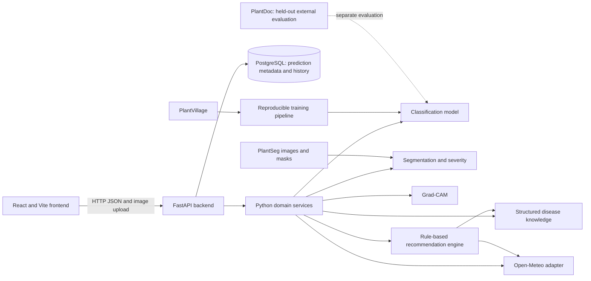

# Architecture

## Components

## Boundaries and data flow

- `src/crop_health/` owns reusable dataset, preprocessing, classification, segmentation, severity, explainability, weather, knowledge-base, and recommendation logic.
- `backend/app/` exposes application services over HTTP and owns request/response validation and persistence integration.
- `frontend/` presents the upload and results workflow and reads history through the API.
- `configs/` holds explicit dataset-to-label mappings and model/training settings. Local dataset files, model weights, database credentials, and weather settings are not hard-coded into the domain package.
- PlantDoc is a separate external evaluation source. It is not a training source.
- PostgreSQL stores prediction metadata and history. Uploaded image binaries are not intended for database storage.
- `backend/app/models.py` defines SQLAlchemy persistence models; `alembic/versions/` owns schema evolution. `DATABASE_URL` configures PostgreSQL in deployment and may point to SQLite for isolated local development/tests.

The backend exposes health, current-weather, source-traceable recommendation, multipart prediction, and prediction-history endpoints. The prediction workflow connects existing classifier inference, optional severity, Grad-CAM, knowledge base, weather, recommendations, and the migrated SQLAlchemy history schema. It requires separately supplied production model artifacts; the smoke checkpoint is not accepted. The React frontend consumes the existing prediction and history endpoints. History uses API pagination and class filtering, opens stored record snapshots, and calculates page-scoped analytics from returned records; see [frontend documentation](frontend.md).

Stage 15 integration validation exercises the upload-to-response-and-history path with the existing preprocessing and recommendation code, injected deterministic test inference, mocked weather, and a temporary migrated SQLite database. These checks validate component contracts and persistence consistency only; they are not classifier evaluation. The OpenAPI service description reflects the implemented routes and production-checkpoint requirement. The production classifier checkpoint is absent, so real production image inference remains unavailable.

Deployment uses a separately hosted FastAPI/Uvicorn service and React/Vite static client. `CORS_ALLOWED_ORIGINS` explicitly configures browser origins; Alembic migrations are a release step, not application-startup behavior. `/health` is a process check, while `/health/ready` checks the configured database and reports classifier asset presence separately without loading weights. See [deployment instructions](deployment.md).
